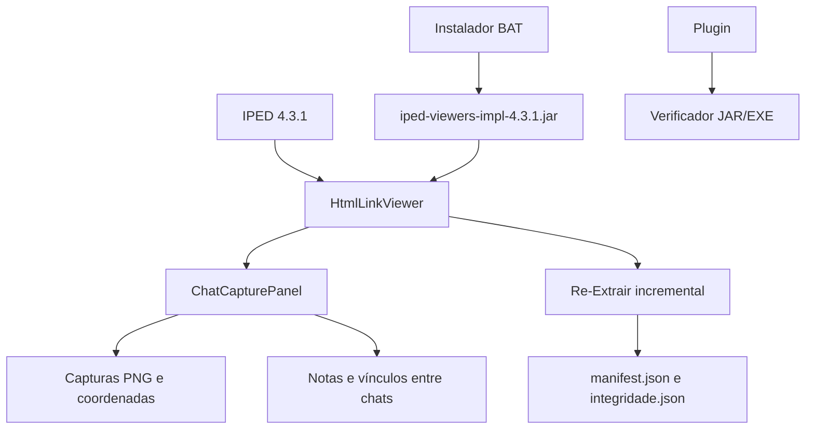

# Plugin Chat Captura IPED

**Versão:** 2.3.1-beta | Data: 06/11/2026.
**Base:** IPED 4.3.1; Java 11.

Este documento descreve o plugin Java que amplia o viewer HTML do IPED para capturar conversas WhatsApp, gerar evidências navegáveis, anotar mensagens e verificar/reextrair capturas.

## Índice

- [Arquitetura](#arquitetura)
- [Recursos](#recursos)
- [Uso no IPED](#uso-no-iped)
- [Instalação e distribuição](#instalação-e-distribuição)
- [Arquivos gerados](#arquivos-gerados)
- [Integridade e segurança](#integridade-e-segurança)
- [Desenvolvimento e validação](#desenvolvimento-e-validação)
- [Limitações conhecidas](#limitações-conhecidas)

## Arquitetura

O artefato do plugin substitui `iped-viewers-impl-4.3.1.jar` no IPED. A captura opera no viewer Java/Swing e gera HTML, JSON, texto, imagens e hashes para cada conversa. O verificador de integridade é um aplicativo independente.

## Recursos

- Captura de intervalo de mensagens entre marcadores inicial e final, com frames PNG e HTML interativo.
- Pesquisa de mensagens e navegação por coordenadas de texto e mídia.
- Notas e vínculos entre conversas; anotações podem ser exportadas com a captura ou salvas em chats existentes.
- Censura visual de miniaturas comparadas com imagens de referência, com parâmetros de similaridade e intensidade de blur.
- Re-Extrair com comparação de inventário, reaproveitamento de conteúdo inalterado e registro de auditoria.
- Registro local de integridade e integração com o verificador independente Local/Público.

## Uso no IPED

1. Abra uma conversa WhatsApp no viewer HTML.
2. Marque a mensagem inicial e final pelo menu de contexto.
3. Escolha a pasta de saída e configure, se necessário, as imagens de referência para censura.
4. Inicie a captura. Revise os arquivos HTML e JSON produzidos.
5. Para atualizar uma captura existente, use **Re-Extrair** e confira o resumo da operação.

O modo de chat salvo permite adicionar ou editar anotações sem uma nova captura, conforme os controles disponíveis nessa tela.

## Instalação e distribuição

Feche o IPED antes de instalar. Extraia o ZIP do instalador e execute `instalar_captura_chat_zap/instalar_captura_chat_zap.bat`. O instalador valida o JAR, cria um backup, substitui o arquivo do plugin e instala os bundles de idioma. Consulte [README.md](README.md) para downloads e instruções detalhadas.

O JAR do plugin é compilado para Java 11. O verificador tem fonte e documentação próprias em `verificador-integridade/`; consulte [`verificador-integridade/README.md`](verificador-integridade/README.md). A versão-fonte do verificador e os binários distribuídos podem divergir até a próxima compilação e atualização dos hashes do plugin; use `CHECKSUMS.md` para conferir cada artefato publicado.

## Arquivos gerados

| Arquivo | Conteúdo |
|---|---|
| `screenshots/frame_*.png` | Imagens capturadas em sequência |
| `whatsapp.html` | Conversa navegável com links e anotações exportadas |
| `whatsapp-coordinates.json` | Coordenadas e dados usados pela página |
| `manifest.json` | Metadados e inventário da captura |
| `integridade.json` | Inventário SHA-256 e histórico de integridade |
| `capturas-index.json` | Índice das capturas para busca e Re-Extrair |
| `texto.txt` | Texto extraído para consulta |
| `integridade/reextracao-auditoria.jsonl` | Eventos operacionais de Re-Extrair |

## Integridade e segurança

Hashes SHA-256 identificam o conteúdo comparado; não são assinatura digital nem provam autoria. Para comparação pública, obtenha a referência por um canal separado e confiável. O histórico encadeia eventos e mantém os hashes e inventários, mas não arquiva versões antigas dos bytes substituídos.

O instalador cria uma cópia de segurança antes de substituir o JAR. Os hashes dos binários publicados ficam em `CHECKSUMS.md`.

## Desenvolvimento e validação

- Fontes Java do plugin: `src/iped/viewers/`.
- Testes unitários: `tests/iped/viewers/`.
- Empacotamento do instalador: `instalar_captura_chat_zap/`.
- Artefato do plugin: `instalar_captura_chat_zap/iped-viewers-impl-4.3.1.jar`.
- O script `validate-plugin-jar.ps1` confere classes e bundles necessários.
- A especificação consolidada está em `ESPEC_UNICA_CHAT_CAPTURE_IPED.md`; ela também registra requisitos parciais ou ainda não entregues.

## Limitações conhecidas

- O plugin requer IPED 4.3.1 e Java 11.
- O hash é um mecanismo de comparação de integridade, não uma assinatura criptográfica de autoria.
- Alguns requisitos descritos em especificações antigas são parciais ou não entregues; consulte a especificação consolidada antes de presumir disponibilidade.
