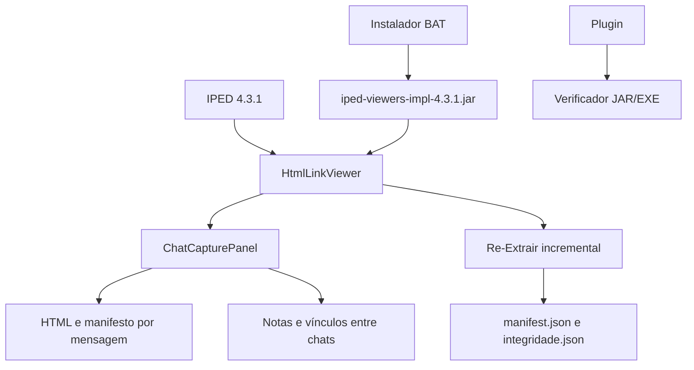

# Plugin Chat Captura IPED

**Versão:** 2.4.0-beta | Data: 07/11/2026.
**Base:** IPED 4.3.1; Java 11.

Este documento descreve o plugin Java que amplia o viewer HTML do IPED para capturar conversas WhatsApp, gerar evidências navegáveis, anotar mensagens e verificar/reextrair capturas.

## Índice

- [Arquitetura](#arquitetura)
- [Recursos](#recursos)
- [Uso no IPED](#uso-no-iped)
- [Instalação e distribuição](#instalação-e-distribuição)
- [Arquivos gerados](#arquivos-gerados)
- [Integridade e segurança](#integridade-e-segurança)
- [Desenvolvimento e validação](#desenvolvimento-e-validação)
- [Limitações conhecidas](#limitações-conhecidas)

## Arquitetura

O artefato do plugin substitui `iped-viewers-impl-4.3.1.jar` no IPED. Novas capturas são `html-message-v1` e registram HTML, mensagens, anexos e hashes por conteúdo. O modo legado baseado em imagens permanece disponível para capturas antigas. O verificador de integridade é um aplicativo independente. O instalador atualiza `org.json` para 20260719 e mantém cópias de segurança da biblioteca substituída.

## Recursos

- Novas capturas de intervalo entre marcadores inicial e final usam `html-message-v1`: HTML offline, `messages.json`, hashes por mensagem e anexos locais por SHA-256. As capturas PNG legadas continuam legíveis.
- Links de anexo do HTML do IPED que usam `app.open('sha-256:...')` são resolvidos pelo hash do item no caso. A captura inclui recursos locais dentro de limites e valida MIME/assinatura antes de gravar.
- PDF, áudio, vídeo, imagem, ZIP/OOXML, Office legado, RAR, 7z, texto/CSV e itens genéricos `.bin` são suportados pela allowlist do formato; um recurso desconhecido interrompe a captura com erro explícito.
- Pesquisa de mensagens e navegação por coordenadas de texto e mídia.
- Notas e vínculos entre conversas; anotações podem ser exportadas com a captura ou salvas em chats existentes.
- Censura visual de miniaturas comparadas com imagens de referência no formato legado PNG. O novo formato HTML interrompe a captura se a pasta de blur estiver ativa, pois ainda não aplica essa censura.
- Re-Extrair com comparação de inventário, reaproveitamento de conteúdo inalterado e registro de auditoria.
- Registro local de integridade e integração com o verificador independente Local/Público.

## Uso no IPED

1. Abra uma conversa WhatsApp no viewer HTML.
2. Marque a mensagem inicial e final pelo menu de contexto.
3. Escolha a pasta de saída. A censura por imagens de referência está disponível no formato legado PNG; em capturas `html-message-v1`, deixe a pasta de blur desativada.
4. Inicie a captura. Revise os arquivos HTML e JSON produzidos.
5. Para atualizar uma captura existente, use **Re-Extrair** e confira o resumo da operação.

O modo de chat salvo permite adicionar ou editar anotações sem uma nova captura, conforme os controles disponíveis nessa tela.

## Instalação e distribuição

Feche o IPED antes de instalar. Extraia o ZIP do instalador e execute `instalar_captura_chat_zap/instalar_captura_chat_zap.bat`. O instalador valida o JAR, cria um backup, substitui o arquivo do plugin e instala os bundles de idioma. Consulte [README.md](README.md) para downloads e instruções detalhadas.

O JAR do plugin é compatível com Java 11. O verificador 1.3.0 tem fonte e documentação próprias em `verificador-integridade/`; consulte [`verificador-integridade/README.md`](verificador-integridade/README.md). O JAR do verificador aceita Java 8 ou superior. Os hashes da build local estão em `CHECKSUMS.md`; estes artefatos ainda não foram publicados em uma release.

## Arquivos gerados

| Arquivo | Conteúdo |
|---|---|
| `screenshots/frame_*.png` | Capturas legadas: imagens em sequência |
| `whatsapp.html` | Capturas legadas: conversa navegável com links e anotações exportadas |
| `whatsapp-coordinates.json` | Capturas legadas: coordenadas e dados usados pela página |
| `manifest.json` | Metadados; `captureFormat` seleciona formato novo ou legado |
| `messages.json` | Formato novo: registros ordenados e hashes por mensagem/anexo |
| `attachments/` | Formato novo: anexos locais nomeados por SHA-256 |
| `message-reconciliation.json` | Formato novo: estados por mensagem produzidos pelo Re-Extrair |
| `integridade.json` | Inventário SHA-256 e histórico de integridade da captura |
| `capturas-index.json` | Índice na raiz da saída para busca e Re-Extrair |
| `texto.txt` | Fluxo legado: texto extraído para consulta |
| `index.html`, `relatorio.htm` | Índice e relatório na raiz da saída |
| `integridade/reextracao-auditoria.jsonl` | Eventos operacionais de Re-Extrair |

No formato `html-message-v1`, `whatsapp.html` contém somente o intervalo selecionado e não executa scripts ou URLs externas. `messages.json` registra `domId`, contexto, chave estável, `messageHash` e anexos locais. `manifest.json` mantém âncoras, `sourceFingerprint`, `conversationKey` e `captureRootHash`. Re-Extrair exige conversa e âncoras únicas, registra mensagens inalteradas/alteradas/novas/não encontradas e só promove a saída depois de validá-la. `-Diped.chat.capture.htmlMessageV1=false` desativa temporariamente a criação de novas capturas nesse formato durante a beta; capturas HTML já existentes continuam usando a reconciliação HTML.

## Integridade e segurança

Hashes SHA-256 identificam o conteúdo comparado; não são assinatura digital nem provam autoria. Para comparação pública, obtenha a referência por um canal separado e confiável. O histórico encadeia eventos e mantém os hashes e inventários, mas não arquiva versões antigas dos bytes substituídos.

Metadados JSON são limitados a 16 MiB, caminhos relativos a 4.096 caracteres, inventários a 25.000 arquivos e eventos cumulativos de auditoria a 16 MiB. O índice do Re-Extrair aceita até 100.000 candidatos; cada página mantém até 100 descritores e recusa metadados acima de 16 MiB. Caminhos absolutos, segmentos `.`/`..`, drives e links simbólicos são recusados ao resolver capturas. O verificador limita cada captura a 25.010 arquivos, o conjunto selecionado a 25.000 itens e 32 MiB de metadados, e os relatórios a 4 Mi caracteres estimados. Limites excedidos geram erro legível e preservam os arquivos anteriores. Escritas usam temporários exclusivos e verificação de links simbólicos nos diretórios de saída.

A descoberta de capturas do verificador e a leitura de páginas do Re-Extrair ocorrem em workers canceláveis com contador de progresso. Os metadados completos são lidos somente quando a página ou o job é processado.

O instalador cria uma cópia de segurança antes de substituir o JAR. Os hashes dos binários locais ficam em `CHECKSUMS.md`.

Limites do novo formato: 25.000 mensagens, 8 MiB por anexo, 64 MiB em anexos por captura, 1 MiB de texto extraído por mensagem e 16 MiB para o HTML fonte. A captura falha sem promover resultado quando uma referência não pode ser resolvida ou validada.

## Desenvolvimento e validação

- Fontes Java do plugin: `src/iped/viewers/`.
- Testes unitários: `tests/iped/viewers/`.
- Empacotamento do instalador: `instalar_captura_chat_zap/`.
- Artefato do plugin: `instalar_captura_chat_zap/iped-viewers-impl-4.3.1.jar`.
- O script `validate-plugin-jar.ps1` confere classes e bundles necessários.
- A especificação consolidada está em `ESPEC_UNICA_CHAT_CAPTURE_IPED.md`; ela também registra requisitos parciais ou ainda não entregues.

## Limitações conhecidas

- O plugin requer IPED 4.3.1 e Java 11.
- A captura precisa ser validada manualmente no WebView do IPED 4.3.1 com exemplos reais de cada tipo de anexo antes de distribuir a versão beta. Os testes automatizados não substituem essa verificação de integração visual.
- O hash é um mecanismo de comparação de integridade, não uma assinatura criptográfica de autoria.
- Alguns requisitos descritos em especificações antigas são parciais ou não entregues; consulte a especificação consolidada antes de presumir disponibilidade.
