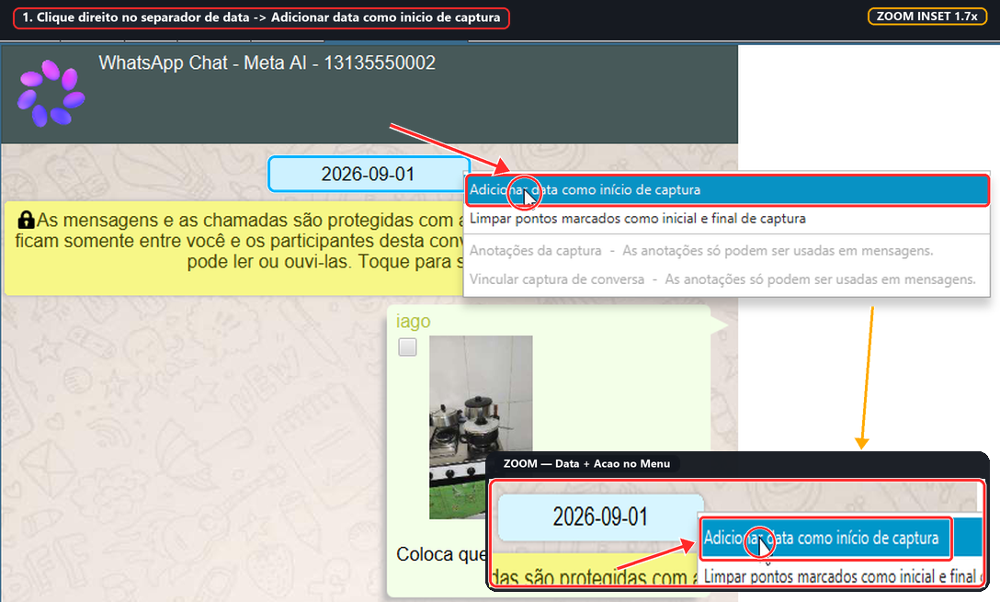
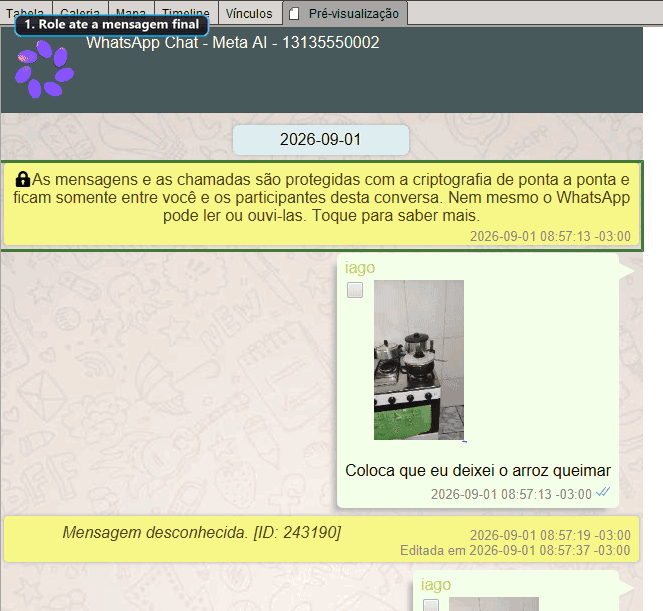
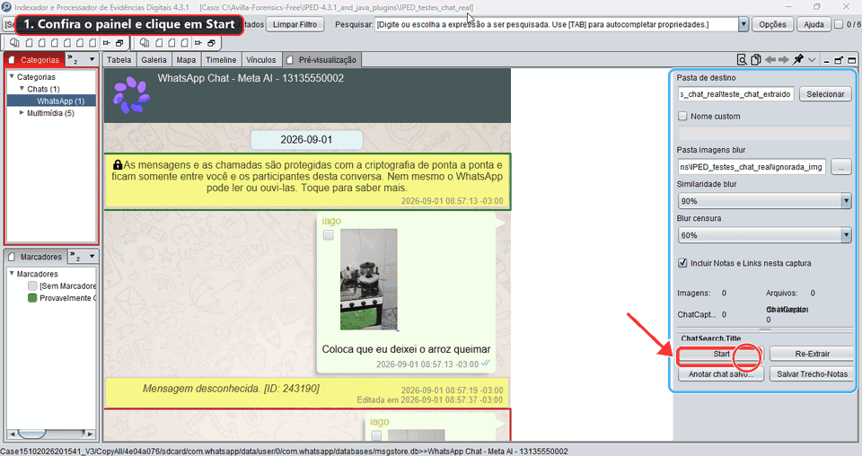
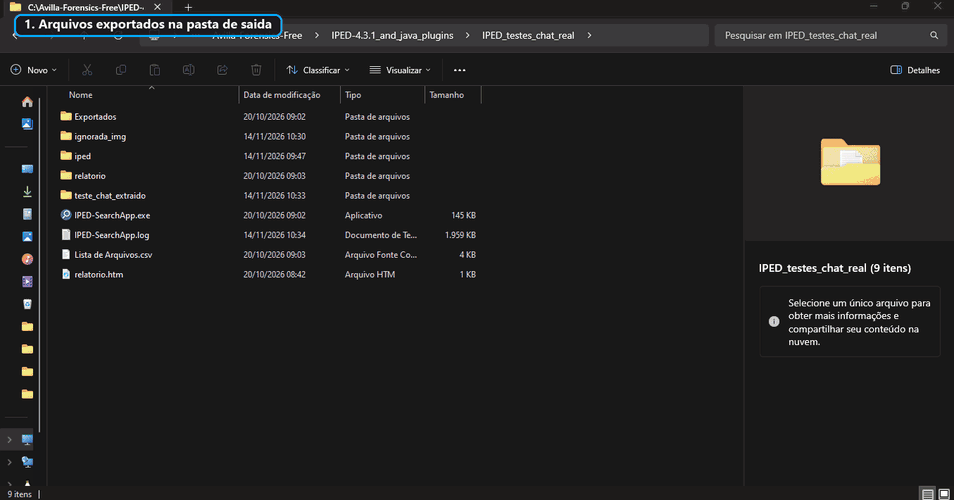

# Guia de Uso — Chat Captura IPED (v2.7.0) e Verificador de Integridade (v1.4.5)

Este guia explica passo a passo como instalar, configurar, capturar trechos de conversas do WhatsApp no **IPED 4.3.1** no formato `html-message-v1`, aplicar censura visual e anotações, re-extrair/migrar capturas antigas e auditar os arquivos gerados com o **Verificador de Integridade 1.4.5**.

> **Documentos técnicos complementares:** consulte [README.md](README.md), [doc.md](doc.md), [CHECKSUMS.md](CHECKSUMS.md) e [verificador-integridade/README.md](verificador-integridade/README.md).
>
> **Mídias deste guia:** as capturas abaixo exibem a versão anotada (com destaque por retângulos, círculos, setas e zoom) em `imagens_doc/edit/`, mantendo os arquivos originais preservados em `imagens_doc/`.

---

## 1. Pré-requisitos e Instalação

- **IPED 4.3.1** com **Java 11** (o plugin `iped-viewers-impl-4.3.1.jar` substitui o viewer padrão mantendo o tema do IPED).
- **Verificador de Integridade (`1.4.5`)**:
  - `integridade-verifier.exe` (Windows x64 autocontido, não exige instalação extra); ou
  - `integridade-verifier.jar` (requer **Java 8 / 1.8 ou superior**).

### Passos para instalar

1. **Feche o IPED** completamente antes de substituir o plugin.
2. Confira os hashes SHA-256 do pacote baixado comparando com [CHECKSUMS.md](CHECKSUMS.md) por um canal confiável e separado.
3. Extraia o pacote do instalador e execute:
   ```bat
   instalar_captura_chat_zap\instalar_captura_chat_zap.bat
   ```
   O script valida automaticamente os hashes esperados do JAR do plugin e dos binários do verificador (`integridade-verifier.jar` e `integridade-verifier.exe`), cria uma cópia de segurança do arquivo anterior e instala a versão atual na pasta de plugins/lib do IPED.
4. Reabra o IPED e abra uma conversa do WhatsApp na aba **Pré-visualização**.

---

## 2. Passo a Passo da Captura no IPED

### Passo 1 — Marcar o início da captura (mensagem ou data)

Na aba **Pré-visualização** de uma conversa no IPED:

1. Navegue até o ponto onde o recorte deve começar (você também pode usar o quadro de **Pesquisa no chat** do painel direito: dê um duplo clique em um resultado para saltar direto até a mensagem).
2. Clique com o botão direito sobre:
   - uma **mensagem** → **Adicionar mensagem inicial de captura**; **ou**
   - um **separador de data** (ex.: `2026-09-01`) → **Adicionar data como início de captura** (o plugin resolve automaticamente para a primeira mensagem daquela data).
3. A âncora inicial marcada recebe uma **borda verde** na conversa.



> **Dica de contexto:** ao clicar com o botão direito sobre um separador de data, as opções **Anotações da captura** e **Vincular captura de conversa** ficam desabilitadas com o aviso *"As anotações só podem ser usadas em mensagens."* Use uma mensagem dentro do intervalo para adicionar notas ou vínculos. Caso precise recomeçar a marcação, clique em **Limpar pontos marcados como inicial e final de captura**.

---

### Passo 2 — Marcar a mensagem final

1. Role a conversa até a última mensagem que deve compor o recorte.
2. Clique com o botão direito sobre essa mensagem e escolha **Adicionar mensagem final de captura**.
   - **Atenção:** o ponto final precisa ser obrigatoriamente uma mensagem (um separador de data não pode ser usado como fim).
   - A mensagem inicial deve estar antes ou ser igual à mensagem final.
3. A mensagem final recebe uma **borda vermelha**, delimitando todo o trecho capturado entre a borda verde e a borda vermelha.



---

### Passo 3 — Configurar o painel lateral direito (`ChatCapturePanel`)

Antes de iniciar, revise os campos do painel lateral direito do visualizador:

| Controle | Função |
| --- | --- |
| **Pasta de destino** / **Selecionar** | Define a pasta raiz onde serão gravados o índice (`index.html`), os verificadores e as subpastas `captura-chat-...`. |
| **Nome custom** | Quando marcado, permite personalizar o nome da subpasta de captura (ex.: `organizacao_nome` ou `organizacao_nome-{timestamp}`). |
| **Pasta imagens blur** / **`...`** | Opcional. Pasta com imagens de referência para detectar miniaturas semelhantes e aplicar censura visual na captura. |
| **Similaridade blur** (`90%`, `75%`, `50%`) | Ajusta a exigência de correspondência visual (quanto maior o percentual, menos imagens diferentes são borradas). |
| **Blur censura** (`90%`, `60%`, `30%`, `20%`) | Intensidade do desfoque aplicado nas miniaturas censuradas. |
| **Incluir Notas e Links nesta captura** | Marcado por padrão. Inclui no pacote gerado as notas periciais e os vínculos de conversa criados no intervalo. |
| Contadores (`Imagens:`, `Arquivos:`, Notas, Links, `Fora do intervalo:`) | Mostram em tempo real os elementos contabilizados no trecho e eventuais anotações/links fora dos limites marcados. |

> [!WARNING]
> **Censura visual (blur) no formato `html-message-v1`:** o blur aplicado é **supressão visual via CSS na apresentação** do HTML offline, não uma tarja destrutiva nos bytes do arquivo. Os arquivos originais em `attachments/` continuam íntegros e podem ser visualizados ao abrir o anexo no modal. Se o objetivo for entrega sem acesso aos bytes sensíveis originais, trate os anexos antes da entrega externa.

---

### Passo 4 — Adicionar anotações e vincular conversas (opcional)

Com o intervalo inicial e final marcados (e com **Incluir Notas e Links nesta captura** ativo):

- **Anotações da captura:** clique com o botão direito sobre qualquer mensagem **dentro do intervalo** e selecione **Anotações da captura** para registrar observações periciais vinculadas àquela mensagem.
- **Vincular captura de conversa:** clique com o botão direito em uma mensagem do trecho e escolha **Vincular captura de conversa** para associar outra conversa relacionada dentro da mesma pasta raiz de destino (o painel indicará **Destino da captura vinculada**).
- **Botões rápidos no painel:**
  - **Anotar chat salvo...**: abre uma captura já salva para consulta/anotação.
  - **Salvar Trecho-Notas**: salva o conjunto de trecho e notas configurados.

---

### Passo 5 — Iniciar a captura (`Start`) e validar o Verificador

1. Com os pontos inicial e final marcados e a **Pasta de destino** selecionada, clique em **Start** (durante o processamento o botão muda para **Stop** para permitir cancelamento).
2. Na primeira captura ou re-extração da sessão, o plugin exibe a janela **Informacao sobre o verificador de integridade**, mostrando o endereço do repositório oficial, orientações de conferência SHA-256 e o status de validade dos binários encontrados:
   - `integridade-verifier.jar: VALIDO (<SHA-256>)`
   - `integridade-verifier.exe: VALIDO (<SHA-256>)`
3. Clique em **OK** para prosseguir com a extração. O plugin copia automaticamente versões validadas do verificador para a pasta de destino quando necessário e gera os arquivos da captura.



---

## 3. Estrutura Gerada na Pasta de Destino

Ao finalizar a captura, a pasta de destino passa a conter:

### Raiz da pasta de destino
- `index.html`: **Índice de Capturas de Chat**, com campo de busca (*Pesquisar chat, ID, pasta ou data*), opção **Ordenar por cronologia**, **Hash geral** e cartões de cada captura com botões **Abrir WhatsApp**, **Abrir Relatório**, **Texto** e **Manifest**.
- `capturas-index.json`: catálogo estruturado utilizado pelo índice e pelo verificador.
- `relatorio.htm`: relatório consolidado da captura.
- `integridade-verifier.exe` e `integridade-verifier.jar`: cópias oficiais validadas do Verificador de Integridade `1.4.2`.

### Dentro de cada subpasta `captura-chat-.../`
- `whatsapp.html`: réplica HTML offline no tema do IPED 4.3.1, com CSP restrita e visualização modal offline para imagens, áudio, vídeo, PDF e documentos (sem conexões remotas).
- `manifest.json`: metadados da captura, limites aplicados, flags de censura e hash raiz (`captureRootHash`).
- `messages.json`: manifesto estruturado por mensagem (`domId`, identificadores e hashes SHA-256 de mensagens e anexos).
- `integridade.json`: inventário completo de arquivos e cadeia encadeada de eventos de integridade.
- `attachments/`: arquivos de mídia e anexos extraídos localmente do caso IPED.

---

## 4. Conferência do Resultado e Verificação de Integridade

A animação abaixo mostra o fluxo completo pós-captura: abertura do `index.html`, inspeção do `whatsapp.html` offline e validação criptográfica tanto no modo **Integridade Local** quanto no modo **Integridade Público** com o `integridade-verifier.exe` v1.4.2.



### 4.1. Navegar pela captura offline

1. Na pasta de destino, abra `index.html` no navegador.
2. Verifique os dados do cartão da captura (`Chat`, `ID`, `Data`, `Cronologia`, `Status: completed`, `Arquivos`, `Tamanho` e hash).
3. Clique em **Abrir WhatsApp** para abrir `whatsapp.html` e navegar pelas mensagens e miniaturas totalmente offline.

### 4.2. Verificação Local (`Integridade Local`)

Use o modo **Integridade Local** para confirmar que os arquivos na pasta de saída conferem integralmente com o `integridade.json` local de cada captura e para gerar os códigos públicos de conferência:

1. Execute `integridade-verifier.exe` (ou `java -jar integridade-verifier.jar`) na pasta raiz das capturas.
2. Na janela inicial, clique em **Integridade Local**.
3. Na tela **Selecione as capturas**, marque as capturas desejadas (ou clique em **Marcar todos**) e clique em **Confirmar**.
4. Ao concluir, o sistema grava o relatório na subpasta `integridade/` e em `integridade.html` na raiz, exibindo a janela **Resultado** com:
   - **SHA-256 do histórico completo público** + botão **Copiar**: hash curto ideal para constar em laudos, autos ou canal separado de validação.
   - **Copiar histórico completo**: copia o `historico-capturas.txt` com os nomes reais das pastas (`CAPTURA|<pasta>-...`).
   - **Copiar histórico completo público**: copia a versão anonimizada (`CAPTURA|*-YYYYMMDD-HHMMSS ...`), protegendo os nomes das pastas caso sejam confidenciais.
   - **Abrir histórico**: abre o arquivo `historico-capturas.txt` gerado.
   - **Abrir relatório HTML**: abre `integridade.html` no navegador.
5. Dentro de `integridade.html`, além de visualizar cada arquivo com status `anexo íntegro` (Esperado vs Encontrado), você pode colar um hash geral ou histórico completo/público e clicar em **Comparar hash geral** ou **Comparar histórico em todas as capturas** — quando tudo confere, a coluna de comparação exibe **OK** em verde (`Histórico confere: X/X capturas OK.`).

### 4.3. Verificação Externa (`Integridade Público`)

Use o modo **Integridade Público** quando receber uma pasta de capturas de terceiros (ou de outro computador) junto com uma referência obtida por canal separado e confiável:

1. Execute `integridade-verifier.exe` e escolha **Integridade Público**.
2. O verificador descobre e valida automaticamente todas as capturas válidas da pasta raiz.
3. Na tela **Integridade Público**, escolha uma das duas formas de comparação:
   - **1. Hash SHA-256 público (de historico-capturas.txt):** cole o hash de 64 caracteres hexadecimais e clique em **Comparar hash público**.
   - **2. Histórico de capturas completo (historico-capturas.txt):** cole o texto completo ou o formato público anonimizado (`CAPTURA|*-YYYYMMDD-HHMMSS`) e clique em **Comparar histórico completo**.
4. Quando o conteúdo confere integralmente, uma mensagem verde é exibida (*"CONFERE: o texto informado corresponde integralmente ao historico-capturas.txt completo calculado."*). Clique em **Continuar para o resumo** para visualizar e exportar o relatório final.

### 4.4. Uso em linha de comando (CLI)

Para automação ou conferência sem interface gráfica:

```bat
integridade-verifier.exe --version
integridade-verifier.exe --self-test
integridade-verifier.exe --verify-only
integridade-verifier.exe --export-history
```

- `--verify-only`: valida localmente todas as capturas descobertas na pasta atual e retorna código diferente de zero em qualquer divergência ou falha (*fail-closed*).
- `--export-history`: emite no stdout os registros e o `SHA-256_HISTORICO_PUBLICO=...`.

---

## 5. Re-Extrair e Migração de Capturas Legadas

Clique em **Re-Extrair** no painel lateral direito para reprocessar capturas já salvas na pasta selecionada:

- **Capturas já em `html-message-v1`:** o plugin reconcilia as mensagens com a conversa aberta. Se não houver alterações no trecho, a captura existente é preservada intacta (`recapture_skipped_content_unchanged`).
- **Migrar capturas legadas para HTML por mensagem:** converte capturas antigas (baseadas em screenshots/frames) para o formato atual `html-message-v1`:
  - A nova captura é construída e validada em pasta temporária irmã antes de substituir a pasta legada (em caso de erro, a captura antiga permanece intacta).
  - As anotações antigas baseadas em coordenadas são preservadas separadamente em `legacy-annotations.json` quando o histórico é mantido.
  - Se a captura legada usava censura por blur, mantenha a **Pasta imagens blur** selecionada durante a migração.
- **Limpar registros e criar como nova captura:** disponível na migração de legado ou em capturas já `html-message-v1`; remove a cadeia/histórico anterior (`migration.json`, `legacy-annotations.json`, reconciliação e auditoria antigas) e inicia uma captura limpa a partir de `capture_created`.

---

## 6. Boas Práticas e Limites Técnicos

- **Confiabilidade da referência:** hashes SHA-256 comprovam consistência íntegra entre a captura e a referência comparada, mas não substituem assinatura digital de autoria. Sempre armazene ou receba o `SHA-256 do histórico completo público` (ou o `historico-capturas.txt`) por um canal separado e confiável.
- **Limites operacionais:**
  - Por captura (`html-message-v1`): até **25.000 mensagens**, **8 MiB por anexo**, **64 MiB em anexos**, **1 MiB** de texto por mensagem, **16 MiB** por JSON ou HTML fonte e **25.000 arquivos** no inventário.
  - No Verificador de Integridade: até **25.010 arquivos** por captura e até **10.000 capturas / 25.000 itens / 32 MiB** de metadados por execução.
