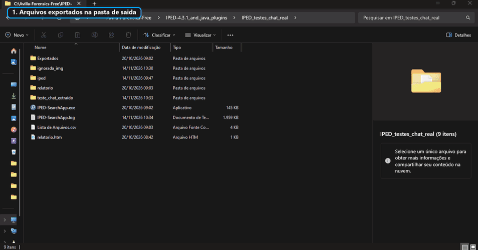

# Chat Captura IPED

Plugin/customização em Java para o **IPED 4.3.1** que captura intervalos de mensagens de chats no viewer HTML, gerando pacote offline auditável (`html-message-v1`) acompanhado pelo **Verificador de Integridade** criptográfico independente (JAR Java 8+ e executável Windows x64 autocontido).

- **Versão atual do plugin:** `2.8.1` (branch `main`)
- **Verificador de Integridade:** `1.5.1`
- **Compatibilidade alvo:** IPED `4.3.1` oficial (Java 11+) | Launcher EXE com runtime `.NET 10.0.15`
- **Build reproduzível auditável (Windows / Linux / macOS):** [`build-reproducible.ps1`](build-reproducible.ps1)
- **Licença e Direitos Autorais:** `Copyright (C) 2026 iagobusca` — [GNU General Public License v3.0 (GPLv3)](LICENSE) ([NOTICE](NOTICE))

---

## Demonstração do Resultado e Verificador de Integridade

Veja abaixo a abertura offline da captura (`index.html` e `whatsapp.html` com modal de anexos) e a conferência criptográfica nos modos **Integridade Local** e **Integridade Público** no Verificador de Integridade:



Para instruções ilustradas passo a passo de instalação, captura, notas, censura e auditoria, consulte o guia completo em [GUIA_DE_USO.md](GUIA_DE_USO.md).

<p align="center">
  <a href="GUIA_DE_USO.md"><kbd>&nbsp;&nbsp;&nbsp;<b>📖 Abrir Guia de Uso Completo — Passo a Passo com Imagens (GUIA_DE_USO.md)</b>&nbsp;&nbsp;&nbsp;</kbd></a>
</p>

---

## Sobre o Projeto

Este repositório mantém o código-fonte, os testes automatizados, o compilador determinístico e o pacote instalador para aplicar a extensão do `HtmlLinkViewer` sobre uma instalação oficial do **IPED 4.3.1** sem exigir recompilação do IPED base:

- **Formato padrão `html-message-v1`:** captura determinística por intervalo DOM de mensagens e anexos recuperados diretamente do caso, tema offline preservado, CSP estrita, modal offline seguro (imagem, áudio, vídeo, PDF e documentos) e tolerância a anexos excedentes ou indisponíveis sem abortar a captura.
- **Verificador de Integridade `1.5.1`:** utilitário independente para auditoria offline (**Integridade Local**), comparação contra referências externas ou histórico público anonimizado `CAPTURA|*-YYYYMMDD-HHMMSS` (**Integridade Público**) e **Auditoria de Origem** (`--audit-origin` / botão **Auditoria de origem...**) confrontando `origin-binding.json` com a pasta Avilla (`Hashs.txt` UTF-16LE, `report.pdf`, `msgstore.db`), caso IPED pai (`Lista de Arquivos.csv`), anexos e mídias embutidas no HTML, com scanner HTML léxico estrito (`scanHtmlElements` / `parseHtmlTagStrict`), proteção `LinkOption.NOFOLLOW_LINKS`, allowlists HTML/MIME simétricas, relatórios em *streaming* transacional sem tetos artificiais e `--self-test`.
- **Allowlist exclusiva de segurança:** o plugin `2.8.1` (`VerifierIntegrity.java`) e o instalador `instalar_captura_chat_zap.bat` aceitam exclusivamente os binários oficiais da série `1.5.1` (rejeitando versões anteriores), além de aplicar `html.disable=true` em renderizadores Swing e limpeza determinística de WebView/OpenCV/executores em `dispose()`.
- **Por que o instalador substitui `iped-viewers-impl-4.3.1.jar`:** no IPED `4.3.1` (`ViewerController.java` e `Bootstrap.java`), os visualizadores interativos são instanciados diretamente no código sem SPI (`ServiceLoader`) para viewers, e `lib/*` antecede `plugins/*` no classpath. O instalador cria backup automático da versão original e injeta apenas o necessário preservando `MultiViewer` e `org/opencv/**`.

---

## Como Instalar

> Antes de executar o instalador, confira o hash SHA-256 do ZIP baixado com os valores publicados em [CHECKSUMS.md](CHECKSUMS.md). O instalador `.bat` também valida todos os hashes dos arquivos extraídos antes de copiar para o IPED.

1. Feche completamente o IPED (para liberar os arquivos `.jar` em uso).
2. Baixe o pacote completo `instalador-chat-captura-IPED-2.8.1-verificador-1.5.1.zip` na página de **Releases** e extraia em uma pasta local.
3. Execute `instalar_captura_chat_zap/instalar_captura_chat_zap.bat`.
4. Reabra o IPED e abra uma conversa do WhatsApp no viewer HTML.

### O que o instalador faz

1. Confere os SHA-256 do fat-JAR do plugin (`2.8.1`), do Verificador JAR/EXE (`1.5.1`) e valida a integridade das classes e bundles do JAR com `validate-plugin-jar.ps1`.
2. Cria backups com carimbo de data/hora (`*.bak-YYYYMMDD-HHMMSS`) de `lib\iped-viewers-impl-4.3.1.jar`, `lib\json-20250517.jar`, `opencv_java4120.dll`, bundles de localização e eventuais verificadores existentes.
3. Substitui `lib\iped-viewers-impl-4.3.1.jar` pelo fat-JAR `2.8.1` (que já embute `org/opencv/**`), atualiza `lib\json-20250517.jar` com os bytes de `org.json` `20260719` mantendo a compatibilidade com o `Class-Path` do IPED (removendo cópias duplicadas em `lib\`) e instala `opencv_java4120.dll`.
4. Instala o Verificador de Integridade `1.5.1` (`.jar` e `.exe`) em `<IPED>\verificador-integridade\` e sincroniza as traduções de interface via `install-localization.ps1`.

---

## Artefatos e SHA-256 (`v2.8.1` / Verificador `1.5.1`)

| Artefato | Tamanho (bytes) | SHA-256 | Finalidade |
| --- | ---: | --- | --- |
| `instalador-chat-captura-IPED-2.8.1-verificador-1.5.1.zip` | `94484019` | `0B7D4F1D4939847FE5909E40C63C37EEE131CD343C4CA7F2400F956F5264EB01` | Instalador completo (plugin `2.8.1`, OpenCV, dependências, scripts e Verificador `1.5.1`) |
| `iped-viewers-impl-4.3.1-2.8.1.jar` | `1543080` | `240B2837DF894809668B7225E5B6D21BB774CB61AA2FA17FFD3FC869E8D3764F` | Fat-JAR do plugin (`Implementation-Version: 2.8.1`; mesmo binário de `iped-viewers-impl-4.3.1.jar`) |
| `integridade-verifier-1.5.1.jar` | `182286` | `9809DEC2088F50F88ED1691544CEF45B029783B04498F65F43ECC5634C06C7A3` | Verificador independente Java 8+ (`SELF_TEST_OK 1.5.1`) |
| `integridade-verifier-1.5.1.exe` | `77638746` | `E03DEA3BFA298E125804AB22A51C113665FEAE58529248E0C3947C34EACB7C6F` | Verificador Windows x64 autocontido com runtime Java + `.NET 10.0.15` |

- Hashes detalhados e histórico: [CHECKSUMS.md](CHECKSUMS.md) | [versao_hash.md](versao_hash.md)
- Notas de lançamento e histórico de alterações: [RELEASE_NOTES.md](RELEASE_NOTES.md) | [CHANGELOG.md](CHANGELOG.md)
- Documentação técnica e especificação consolidada: [doc.md](doc.md) | [espec.md](espec.md) | [verificador-integridade/README.md](verificador-integridade/README.md)

---

## Compilação Determinística e Auditoria Bit a Bit

Qualquer auditor em **Windows**, **Linux** ou **macOS** pode baixar o código-fonte da tag `v2.8.1` e recompilar os artefatos com os mesmos hashes SHA-256 exatos usando [`build-reproducible.ps1`](build-reproducible.ps1) (PowerShell 7+ / `pwsh` ou Windows PowerShell 5.1):

```powershell
pwsh -NoProfile -File ./build-reproducible.ps1 -DownloadDeps -PinTemurin -VerifyReproducibility -RunTests
```

- **Windows (`-Target auto` -> `full`):** gera `integridade-verifier.jar`, `iped-viewers-impl-4.3.1.jar`, `integridade-verifier.exe` e o ZIP instalador completo, compilando duas vezes e comprovando igualdade bit a bit (`REPRODUCIBLE_BUILD_VERIFIED=PASS`).
- **Linux / macOS (`-Target auto` -> `jar-only`):** gera e valida deterministicamente `integridade-verifier.jar`, `iped-viewers-impl-4.3.1.jar` e o pacote portátil de JARs usando exatamente o mesmo `Temurin JDK 21.0.13+9`, `OpenJFX 21.0.5` e `IPED 4.3.1` oficial verificados por SHA-256.

---

## Principais Recursos e Uso no IPED

1. **Captura por intervalo (`html-message-v1`):** no viewer HTML de uma conversa WhatsApp, clique com o botão direito para marcar a mensagem inicial e a mensagem final, informe a pasta de destino e clique em **Start** (separadores de data como início resolvem automaticamente para a próxima mensagem).
2. **Notas e Links por mensagem:** marque trechos com anotações do analista e/ou vincule outras conversas do caso em uma janela auxiliar com captura própria; todas as anotações são marcadas como `"notOriginalEvidence": true` em `anotacoes.json` sem modificar o caso original.
3. **Pesquisa no chat e no HTML offline:** busca textual normalizada (sem acentos/maiúsculas) em todo o chat carregado dentro do IPED e busca por conteúdo nos relatórios offline gerados.
4. **Censura visual por imagem de referência:** compare miniaturas com uma pasta de referência (similaridade `50%` / `75%` / `90%` e intensidade `20%` / `30%` / `60%` / `90%`). Em `html-message-v1`, a supressão visual de apresentação usa CSS (`filter: blur(...)` + aviso visual), mantendo os bytes originais íntegros em `attachments/` e fora da fórmula de hash público das mensagens.
5. **Re-Extrair e migração de capturas legadas:** refaça capturas existentes com reconciliação por mensagem (descartando regravação quando nada mudou) ou migre capturas PNG antigas (`version: 1`) de forma transacional para `html-message-v1`, com opção **Limpar registros e criar como nova captura**.
6. **Auditoria de Origem (opcional na captura) e Verificador `1.5.1`:** ao informar **Origem Avilla (opcional)** e/ou **Caso IPED pai (opcional)** no painel de captura, o plugin vincula `origin-binding.json` (lendo `report.pdf` via PDFBox, `Hashs.txt` UTF-16LE, `Lista de Arquivos.csv` do caso pai, cópia temporária read-only N3 do `msgstore.db` e registro explícito de eventual lacuna pós-`.tar` sem alterar `captureRootHash` nem capturas legadas). Na tela inicial do Verificador (`integridade-verifier.exe` ou `java -jar integridade-verifier.jar`), escolha **Integridade Local**, **Integridade Público** (`historico-capturas.txt` original ou público anonimizado `CAPTURA|*`) ou **Auditoria de origem...** (para selecionar **Pasta de origem**, **Pasta do caso (opcional)**, executar **Validar Auditoria**, ler/copiar o conteúdo e gerar **`Auditoria_relatorio.htm`** em **Exportar Auditoria**; ou via CLI `--audit-origin`, gravando `integridade/auditoria-origem.txt`).

### Principais arquivos gerados (`html-message-v1`)

- Na pasta da captura: `whatsapp.html`, `messages.json`, `manifest.json`, `integridade.json`, `attachments/` e, quando aplicável, `origin-binding.json`, `anotacoes.json`, `message-reconciliation.json`, `migration.json` e `legacy-annotations.json`.
- Na raiz da saída: `capturas-index.json`, `index.html`, `relatorio.htm`, `integridade/auditoria-origem.txt` / `Auditoria_relatorio.htm` (quando executada/exportada a Auditoria de Origem) e cópias verificadas do Verificador de Integridade.

---

## Estrutura do Repositório

```text
chat-captura IPED/
  LICENSE
  NOTICE
  README.md
  GUIA_DE_USO.md
  CHANGELOG.md
  CHECKSUMS.md
  RELEASE_NOTES.md
  versao_hash.md
  doc.md
  espec.md
  LEIA-ME.txt
  build-reproducible.ps1
  src/iped/viewers/              # Codigo-fonte do plugin (20 classes Java)
  tests/iped/viewers/            # Testes unitarios Java, integridade e OpenCV
  teste_antes_de_aplicar/        # Suites Python/PowerShell/Java e contratos de integridade
  instalar_captura_chat_zap/     # Instalador .bat, validate-plugin-jar.ps1, dependencias, bundles e JAR compilado
  verificador-integridade/       # Codigo-fonte Java 8, launcher .NET 10 win-x64, testes e binarios
  .github/workflows/             # Pipeline oficial de release no GitHub Actions (com atestado Sigstore)
  .gitea/                        # Workflows e scripts para GiteaRunner (release, cut-release 1-click e deploy local)
```

---

## Licença e Direitos Autorais (GNU GPLv3 — Seção 5(a))

- **Copyright (C) 2026 `iagobusca`**
- Este projeto é distribuído sob os termos da licença **GNU General Public License v3.0 (GPLv3)** — consulte o arquivo [`LICENSE`](LICENSE) para o texto integral.
- **Aviso de modificação (GPLv3 Seção 5(a)):** este trabalho deriva e estende o componente `iped-viewers-impl` do [IPED 4.3.1](https://github.com/sepinf-inc/IPED) (licenciado originalmente sob GNU GPLv3 pelos autores do IPED / SEPINF), modificado e ampliado por **`iagobusca`** entre **2026-10-31 e 2026-11-17** (captura `html-message-v1`, auditoria de origem `origin-binding.json`, anotações/links, busca no chat, censura por similaridade, Re-Extrair/migração transacional, allowlists e Verificador de Integridade independente). Consulte [`NOTICE`](NOTICE) para a relação completa de arquivos modificados/criados e datas.
