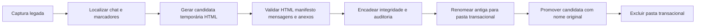

# Especificação técnica — migração de capturas legadas no Re-Extrair

**Estado:** implementada e validada automaticamente; falta a validação manual no IPED 4.3.1.  
**Alvo:** Chat Captura IPED para IPED 4.3.1.  
**Versão de origem:** plugin 2.5.4-beta; Verificador de Integridade 1.3.3.  
**Versão de entrega:** plugin 2.5.6-beta; Verificador de Integridade 1.3.4.  
**Revisão 2.5.6-beta:** o mesmo toggle de limpeza também se aplica a capturas já existentes em `html-message-v1`, sem exigir migração.  
**Objetivo:** permitir que o Re-Extrair substitua, quando solicitado, uma captura legada baseada em frames por uma captura `html-message-v1` do mesmo intervalo de mensagens.

## 1. Resultado esperado

Uma captura legada contém, em geral, `screenshots/frame_*.png`, `whatsapp-coordinates.json` e um `manifest.json` sem `captureFormat: "html-message-v1"`. Ela possui marcadores suficientes para o Re-Extrair localizar o chat, a mensagem inicial e a final, mas não possui `messages.json` nem hashes individuais das mensagens.

Ao marcar **Migrar capturas legadas para HTML por mensagem**, o analista pede uma troca de formato. Para cada captura legada selecionada e válida, o plugin deve:

1. localizar a conversa original no IPED;
2. localizar de forma única os marcadores inicial e final persistidos;
3. extrair somente esse intervalo com o gerador `html-message-v1`;
4. gravar a nova captura em pasta temporária irmã da pasta antiga;
5. validar manifesto, HTML, mensagens, anexos e inventário;
6. registrar a migração na cadeia de integridade;
7. substituir a pasta antiga somente depois de todas as etapas anteriores terem passado.

Após a promoção bem-sucedida, a pasta mantém o mesmo nome. Os frames, coordenadas e demais arquivos do formato antigo são removidos junto da pasta anterior. A nova pasta contém `whatsapp.html`, `messages.json`, `attachments/`, `manifest.json`, `integridade.json` e os demais artefatos do formato por mensagem.

## 2. Evidência do comportamento atual

O código atual identifica o formato somente por `captureFormat`:

```java
job.htmlMessageCapture = "html-message-v1".equals(savedManifest.optString("captureFormat"));
```

Assim, a captura antiga segue o fluxo de screenshots mesmo quando o Re-Extrair reencontra corretamente seus marcadores. A escolha do gerador também depende do mesmo campo:

```java
activeRecaptureJob != null && activeRecaptureJob.htmlMessageCapture
```

Por isso, as 38 capturas verificadas em `F:\Download\Avilla-Acquisitions\teste_captura` continuam no formato de frames: todas têm manifesto legado e coordenadas, mas nenhuma contém `captureFormat: "html-message-v1"` ou `messages.json`.

O fluxo atual já protege a substituição: a nova pasta é construída em `.__reextract_tmp_*`; a pasta antiga é renomeada apenas no momento da promoção, e é restaurada se a segunda movimentação falhar. Esta propriedade deve permanecer.

## 3. Decisão de produto

### 3.1 Toggle explícito

Adicionar na janela **Re-Extrair capturas** o checkbox:

```text
Migrar capturas legadas para HTML por mensagem
```

- Inicia desmarcado.
- Permanece visível em todas as páginas da seleção e conserva seu estado durante a navegação Anterior/Próximo.
- Aplica-se apenas a itens legados selecionados. Capturas que já são `html-message-v1` seguem o fluxo normal de comparação por mensagem.
- O texto de ajuda deve informar: “A migração recria a captura no formato atual e substitui os frames após validar a nova pasta.”
- Se não houver captura legada selecionável na página, o checkbox pode permanecer visível, mas desabilitado, com explicação curta.

### 3.2 Toggle para criar uma captura nova sem histórico

Adicionar abaixo do primeiro controle o checkbox dependente:

```text
Limpar registros e criar como nova captura
```

Regras da interface:

- Inicia desmarcado e desabilitado.
- Para capturas legadas, só é habilitado quando **Migrar capturas legadas para HTML por mensagem** estiver marcado.
- Para capturas já existentes em `html-message-v1`, é habilitado independentemente da migração, pois não há mudança de formato envolvida.
- Se o primeiro toggle for desmarcado e não houver captura nova selecionável, este também é desmarcado imediatamente.
- Conserva seu estado entre as páginas Anterior/Próximo.
- Aplica-se às capturas selecionadas elegíveis: legadas migradas ou já `html-message-v1`; não altera o comportamento de capturas fora da seleção.
- O texto de ajuda deve dizer: “Remove a cadeia e os registros da captura anterior. O resultado será tratado como uma nova captura após a validação.”

Quando este segundo toggle estiver marcado, a migração não transporta `integridade.json`, eventos anteriores, `reextracao-auditoria.jsonl`, `message-reconciliation.json`, frames, coordenadas ou anotações legadas. A pasta promovida recebe somente os artefatos que uma captura HTML por mensagem recém-criada produziria, incluindo um novo `integridade.json` com a ação inicial `capture_created`.

O toggle é uma escolha intencional para iniciar uma nova referência de integridade. Depois de promovida, a nova captura não declara, dentro da própria pasta, vínculo ou continuidade com a captura legada removida.

### 3.3 Regra de ignorar sem alteração

Há duas situações distintas:

| Situação | Regra |
|---|---|
| Captura já em `html-message-v1`, sem limpar registros | Se o inventário, a origem e os hashes das mensagens do intervalo forem iguais, descartar a pasta temporária e registrar `recapture_skipped_content_unchanged`. Não substituir a captura. |
| Captura já em `html-message-v1`, com limpar registros | Ignorar a comparação de conteúdo, recapturar o intervalo e promover a candidata com uma cadeia nova iniciada em `capture_created`. |
| Captura legada com toggle de migração desligado | Manter o fluxo legado atual de screenshots. |
| Captura legada com apenas o primeiro toggle ligado | A migração é uma mudança explícita de formato solicitada pelo analista. Criar a primeira captura HTML por mensagem mesmo sem ser possível comparar hashes de mensagens da versão de frames. Preservar a cadeia anterior. |
| Captura legada com os dois toggles ligados | Sempre recriar como uma nova captura HTML por mensagem, apagar os registros anteriores após a promoção e não preservar a cadeia. |

A primeira migração não deve afirmar que o conteúdo antigo era igual ao atual: os frames não possuem inventário de mensagens para permitir essa conclusão. Ela registra somente que o intervalo foi localizado e reconstruído a partir da fonte atual do IPED. Depois da migração, as execuções seguintes passam a usar os hashes por mensagem e podem ignorar intervalos sem alterações.

## 4. Alterações de modelo e fluxo

### 4.1 `RecaptureJob`

Em `HtmlLinkViewer.RecaptureJob`, manter o estado original e acrescentar:

```java
boolean legacyCapture;
boolean migrateLegacyToHtml;
boolean resetLegacyRecords;

boolean targetHtmlMessageCapture() {
    return htmlMessageCapture || (legacyCapture && migrateLegacyToHtml);
}
```

Regras de carregamento:

- `htmlMessageCapture` continua significando que a pasta de origem já é `html-message-v1`.
- `legacyCapture` é verdadeiro quando `htmlMessageCapture` é falso.
- `migrateLegacyToHtml` é definido no worker do lote a partir do toggle e somente para a captura legada selecionada.
- `resetLegacyRecords` é definido quando o alvo é `html-message-v1`, isto é, em uma captura já HTML ou em uma captura legada com migração explicitamente solicitada. Na captura legada, continua exigindo `migrateLegacyToHtml`.
- `targetHtmlMessageCapture()` é a única decisão usada pelo gerador durante o Re-Extrair. Não alterar a classificação persistida antes de a nova pasta passar na validação.

### 4.2 Propagação da opção

Alterar as assinaturas abaixo para receber `boolean migrateLegacyToHtml` e `boolean resetLegacyRecords`:

```java
startRecaptureBatch(...)
runRecaptureBatch(...)
recaptureOne(...)
```

No início de cada item carregado em `runRecaptureBatch`, definir:

```java
job.migrateLegacyToHtml = migrateLegacyToHtml && job.legacyCapture;
job.resetLegacyRecords = resetLegacyRecords && job.targetHtmlMessageCapture();
```

O worker sempre recarrega o manifesto antes de processar cada item. Portanto a opção deve ser reaplicada depois desse recarregamento; ela não pode depender dos descritores leves descartados pela paginação da janela.

### 4.3 Preparação e decisão de captura

Em `recaptureOne`:

1. abrir o chat e localizar o intervalo antes de criar qualquer arquivo;
2. se `job.resetLegacyRecords` ou `job.migrateLegacyToHtml`, pular `tryMigrateOrSkipCapture`: a troca de formato ou a recriação foi solicitada explicitamente;
3. se `job.htmlMessageCapture` e `job.resetLegacyRecords`, ignorar a verificação de conteúdo descrita em 4.5 e recapturar de fato;
4. se `job.htmlMessageCapture` sem reset, executar a verificação de conteúdo descrita em 4.5;
5. se `job.legacyCapture` sem migração, manter o caminho existente;
6. criar o resultado temporário usando `targetHtmlMessageCapture()`.

Em `runChatCaptureInternal`, substituir a condição que consulta diretamente `activeRecaptureJob.htmlMessageCapture` por:

```java
activeRecaptureJob != null && activeRecaptureJob.targetHtmlMessageCapture()
```

O modo normal de uma nova captura continua usando `htmlMessageCaptureEnabled`. Esta mudança só altera a decisão quando há um `RecaptureJob` legada com migração explicitamente solicitada.

### 4.4 Reutilização segura dos anexos na recriação limpa

No modo `resetLegacyRecords` aplicado a uma captura legada, a captura deve ser nova do ponto de vista de metadados e histórico, mas pode reaproveitar bytes de anexos já presentes na pasta legada para evitar extrair ou copiar novamente o mesmo conteúdo. Em uma captura que já é `html-message-v1`, o reset não usa esse índice: os anexos são extraídos novamente da fonte atual.

Criar um índice temporário de reuso, válido somente durante a geração da candidata:

```java
Map<String, List<ReusableAttachment>> reusableBySha256;
```

Cada `ReusableAttachment` contém somente caminho relativo validado, tamanho e SHA-256 recalculado. A origem elegível é exclusivamente um arquivo regular contido nas pastas de anexos da captura legada, tais como `anexos/` e os caminhos declarados no manifesto antigo. Não indexar `screenshots/`, `whatsapp.html`, arquivos JSON, registros de integridade, arquivos de auditoria, arquivos fora da pasta da captura nem links simbólicos.

Para cada anexo que a extração atual do IPED precisa gravar:

1. obter o SHA-256 e o tamanho esperados da origem atual do IPED;
2. procurar uma entrada do índice com o mesmo SHA-256 e tamanho;
3. recalcular o SHA-256 do arquivo legado escolhido em fluxo antes da cópia;
4. copiar os bytes para a pasta temporária da nova captura, sem usar hard link;
5. recalcular o hash do arquivo copiado e exigir igualdade com o esperado;
6. se qualquer comparação falhar, descartar a cópia temporária e extrair o anexo normalmente a partir da origem atual.

O MIME, nome exibido, tipo, caminho dentro de `attachments/` e vínculo com a mensagem devem ser calculados de novo pela fonte atual. Nunca reutilizar metadados antigos apenas porque o nome do arquivo coincide. `whatsapp.html`, `messages.json`, `manifest.json`, `integridade.json` e todos os registros são sempre gerados de novo.

O índice de reuso deve respeitar os mesmos limites de caminho, quantidade de arquivos, tamanho individual e tamanho total usados pelo inventário. Ele é mantido apenas em memória durante uma captura; não deve ser salvo na pasta final ou no manifesto.

### 4.5 Validação da captura candidata

A migração deve reutilizar a geração já existente de `runHtmlMessageCapture`, inclusive seus limites de tamanho, sanitação do HTML, cópia confinada de anexos, hashes de mensagens e CSP fixa.

Antes da promoção, exigir todos os itens abaixo:

- `manifest.json` contém `captureFormat: "html-message-v1"`, `state: "complete"`, `anchors.start` e `anchors.end` numéricos;
- `messages.json` existe, contém ao menos uma mensagem e suas chaves são únicas;
- `whatsapp.html` existe, passa a validação interna do renderizador e tem hash igual ao registrado no manifesto;
- anexos são locais, confinados à pasta temporária e conferem com os hashes do manifesto;
- `CaptureIntegrity.artifactInventory` conclui sem caminhos inseguros, links simbólicos ou limites excedidos;
- a nova conversa possui o mesmo `conversationKey` calculado para o chat localizado. Falhar se estiver vazia ou divergente.

### 4.6 Comparação para HTML por mensagem já existente

Refatorar `writeHtmlMessageReconciliation` para separar cálculo de persistência:

```java
HtmlMessageReconciliation reconcileHtmlMessages(Path previousCapture, Path candidateCapture)
```

O objeto de retorno deve trazer `unchanged`, `changed`, `missingInCurrentSource`, `newInInterval`, o JSON da reconciliação e `hasContentChange()`.

Para uma captura já HTML:

1. gerar a candidata temporária se a origem ou o inventário não puderem ser descartados pelo atalho atual;
2. calcular a reconciliação sem promover a candidata;
3. se `changed == 0`, `missingInCurrentSource == 0` e `newInInterval == 0`, excluir apenas a candidata temporária, manter a pasta atual e anexar o evento `recapture_skipped_content_unchanged` ao log de auditoria;
4. se houver qualquer diferença, gravar `message-reconciliation.json` na candidata, atualizar `captureRootHash`, validar e promover.

Isso evita substituir uma captura quando a conversa mudou fora do intervalo marcado, mas as mensagens capturadas continuam idênticas.

### 4.7 Proveniência da migração com histórico preservado

Antes de gravar o `manifest.json` da candidata migrada, inserir um objeto opcional e imutável por inventário:

```json
"migration": {
  "schemaVersion": 1,
  "action": "legacy_screenshot_capture_migrated_to_html_message_v1",
  "sourceFormat": "legacy-screenshot",
  "previousIntegrityContentRootHash": "<hash ou vazio>",
  "previousIntegrityRecordHash": "<hash ou vazio>",
  "previousManifestSha256": "<sha256>",
  "anchorsRecoveredFrom": "manifest-and-whatsapp-coordinates"
}
```

Não registrar texto de mensagens, caminho absoluto, dados do caso ou identificadores externos adicionais nesse objeto.

Quando `resetLegacyRecords` for falso, substituir a ação genérica enviada a `appendIntegrityHistory` por:

```text
legacy_screenshot_capture_migrated_to_html_message_v1
```

para a migração. O mecanismo existente de `integridade.json` preserva os eventos anteriores, encadeia `previousRecordHash` e registra a remoção dos frames e a inclusão dos artefatos HTML no inventário.

O registro de migração também deve ser gravado como `migration.json`. O mesmo objeto é referenciado em `manifest.json` nos campos `migration`, `migrationFile` e `migrationSha256`. `migration.json` e `legacy-annotations.json`, quando houver, entram no inventário de `integridade.json`; assim o histórico local vincula os dados de proveniência mesmo que o hash raiz `html-message-v1` permaneça compatível com o formato anterior.

**Correção descoberta na validação:** o Verificador 1.3.3 retornava de `verifyMessageCapture` antes de ler `integridade.json` para capturas `html-message-v1`. Por isso não conferia o histórico local dessas capturas. O Verificador 1.3.4 deve validar a captura por mensagem e, em seguida, validar a cadeia local e exigir que `migration.json` e as anotações preservadas estejam referenciados no inventário. Se `migration.json` for alterado, a verificação deve acusar a divergência mesmo quando o manifesto e o arquivo alterado forem atualizados juntos.

Adicionar também, dentro da nova pasta, uma linha em `reextracao-auditoria.jsonl`:

```json
{"action":"legacy_screenshot_capture_migrated_to_html_message_v1","sourceFormat":"legacy-screenshot","result":"promoted"}
```

O horário e os campos de auditoria são adicionados pelo método existente. O arquivo de auditoria permanece fora do inventário de conteúdo, como já definido pelo projeto.

Quando `resetLegacyRecords` for verdadeiro, não gravar o objeto `migration`, não chamar `appendIntegrityHistory`, não copiar `legacy-annotations.json` e não criar uma linha de auditoria. Deixar o `integridade.json` que a criação da candidata produz, com uma cadeia nova iniciada em `capture_created`.

## 5. Segurança, anotações e falhas controladas

### 5.1 Censura por imagens de referência

O formato HTML por mensagem não suporta a pasta de imagens de referência para blur. Se o toggle de migração estiver marcado e existir uma pasta de blur configurada, bloquear o lote antes de processar a primeira captura legada, com mensagem localizada. Não gerar uma cópia HTML sem censura a partir de uma captura que usava esse recurso.

### 5.2 Anotações legadas

Anotações baseadas em coordenadas não podem ser atribuídas automaticamente a uma mensagem HTML sem uma correspondência verificável. A migração deve:

1. manter os dados brutos antigos de anotação em `legacy-annotations.json` dentro da candidata quando existirem;
2. marcar no manifesto `migration.legacyAnnotationsPreserved: true`;
3. não apresentá-las como anotações vinculadas a mensagens novas;
4. incluí-las no inventário e na cadeia de integridade.

Se a leitura das anotações antigas for inválida ou exceder o limite de metadados, cancelar a migração daquela pasta e preservar a captura legada. Esta regra é aplicada somente quando o histórico for preservado. Com **Limpar registros e criar como nova captura** marcado, as anotações legadas são descartadas junto com os demais registros, conforme a escolha explícita do usuário.

### 5.3 Falha e substituição

Nenhum arquivo da pasta antiga pode ser alterado antes de a candidata estar íntegra. A ordem obrigatória é:



Se B, C, D ou E falhar, excluir somente a candidata temporária. Se G falhar, restaurar a pasta transacional ao nome original. A remoção definitiva da pasta transacional acontece somente depois de G; se falhar, usar o mecanismo existente de quarentena `.iped-reextract-trash` e registrar o fato no log.

## 6. Interface e mensagens localizadas

Adicionar nos dois arquivos `iped-viewer-messages*.properties`:

| Chave | Português esperado |
|---|---|
| `ChatCapturePanel.MigrateLegacyToHtml` | Migrar capturas legadas para HTML por mensagem |
| `ChatCapturePanel.MigrateLegacyToHtmlTip` | Recria a captura no formato atual e substitui os frames após validar a nova pasta. |
| `ChatCapturePanel.MigrateLegacyUnavailable` | Não há capturas legadas elegíveis nesta página. |
| `ChatCapturePanel.ResetLegacyRecords` | Limpar registros e criar como nova captura |
| `ChatCapturePanel.ResetLegacyRecordsTip` | Remove a cadeia e os registros da captura anterior. O resultado será tratado como uma nova captura após a validação. |
| `ChatCapturePanel.MigrateLegacyBlurUnsupported` | A migração para HTML por mensagem não pode usar imagens de referência para censura. Remova essa pasta ou execute sem migração. |
| `ChatCapturePanel.MigratingLegacy` | Migrando captura legada para HTML por mensagem... |
| `ChatCapturePanel.MigrationCompleted` | Captura legada migrada para HTML por mensagem. |
| `ChatCapturePanel.ContentUnchanged` | O intervalo não mudou; a captura atual foi preservada. |
| `ChatCapturePanel.MigrationAnnotationsPreserved` | As anotações legadas foram preservadas separadamente e não foram vinculadas às mensagens novas. |

Durante a migração, a etapa 4 de progresso deve dizer **Extraindo mensagens e anexos para HTML...**, e a etapa 6 **Substituindo a captura legada validada...**. Não exibir “capturando imagens” quando o destino é HTML.

## 7. Testes antes da aplicação

Criar testes em `teste_antes_de_aplicar/` e executá-los antes de editar o fluxo de produção. Cada teste deve usar cópias temporárias; nenhum teste pode tocar `F:\Download\Avilla-Acquisitions\teste_captura`.

### 7.1 Testes de decisão

Criar `test_legacy_recapture_migration_policy.py` ou equivalente Java puro para validar:

1. legado + toggle desligado → destino screenshots;
2. legado + toggle ligado → destino `html-message-v1`;
3. HTML existente + toggle ligado → continua HTML, sem marcar migração legada;
4. HTML existente sem diferenças → `SKIP_CONTENT_UNCHANGED`;
5. HTML existente com mensagem alterada, nova ou ausente → `PROMOTE_HTML_CANDIDATE`;
6. legado sem marcadores utilizáveis → `INVALID`, sem pasta temporária;
7. legado com blur configurado + toggle ligado → bloqueio antes de criar arquivos.
8. segundo toggle sem o primeiro → estado impossível, corrigido para ambos desmarcados;
9. legado com os dois toggles → `TARGET_HTML_MESSAGE_RESET`;
10. HTML existente com o segundo toggle selecionado pela interface → manter o fluxo normal HTML e não limpar sua cadeia.

### 7.2 Fixture de migração

Usar uma pasta temporária que reproduza um manifesto legado versão 3, `whatsapp-coordinates.json`, `screenshots/frame_0001.png` e `integridade.json`. Gerar uma candidata `html-message-v1` a partir do fixture de HTML IPED 4.3.1 já usado pelos testes existentes. Validar:

- a pasta final mantém o nome antigo;
- `screenshots/` e `whatsapp-coordinates.json` não estão na pasta promovida;
- `messages.json`, `attachments/`, `whatsapp.html` e `manifest.json` estão presentes;
- o manifesto inclui `migration` com hashes de origem válidos;
- `integridade.json` contém a ação de migração e cadeia anterior;
- o verificador 1.3.4 aceita a captura promovida;
- o verificador informa as mudanças de inventário sem classificar a migração como adulteração.

Criar uma segunda variação do mesmo fixture com ambos os toggles marcados e confirmar:

- não existe `migration`, `legacy-annotations.json`, `message-reconciliation.json` nem `reextracao-auditoria.jsonl` na pasta promovida;
- `integridade.json` contém somente o evento inicial `capture_created`, sem `previousRecordHash`;
- nenhum frame ou coordenada antiga foi copiado;
- um anexo igual presente em `anexos/` foi reutilizado somente quando SHA-256 e tamanho conferiram;
- um anexo com mesmo nome, mas bytes diferentes, não foi reutilizado;
- o Verificador identifica a pasta como uma captura nova íntegra.

### 7.3 Testes de transação

Simular falha em cada ponto: âncora ausente, conversa divergente, HTML inválido, anexo ausente, gravação de manifesto e promoção da pasta. Em todos os casos, conferir que a pasta legada original e seus hashes permanecem idênticos e que só diretórios temporários/quarentena podem ser criados.

### 7.4 Teste de intervalo inalterado

Partindo de uma captura HTML por mensagem, alterar a fonte apenas fora dos marcadores. A execução deve calcular a candidata, concluir que as mensagens do intervalo são iguais, excluir a candidata e registrar `recapture_skipped_content_unchanged`. Em seguida, alterar uma mensagem dentro do intervalo e confirmar a promoção com `message-reconciliation.json` mostrando `changed: 1`.

### 7.5 Regressões obrigatórias

Executar, além dos novos testes:

```powershell
pwsh -NoProfile -ExecutionPolicy Bypass -File teste_antes_de_aplicar\run_all_tests.ps1
python -m unittest teste_antes_de_aplicar.renderizacao_whatsapp.test_rendering_spec -v
python -m unittest teste_antes_de_aplicar.test_verifier_java_integration -v
```

Validar também uma execução manual no IPED 4.3.1 com uma cópia temporária de uma captura antiga: selecionar uma única pasta, marcar o toggle, confirmar o formato final e conferir a ação de migração pelo verificador.

## 8. Entrega

1. Implementar e testar a migração, o modo de criação limpa e o reuso seguro de anexos no código-fonte.
2. Atualizar `HtmlLinkViewer.CHAT_CAPTURE_PLUGIN_VERSION` para `2.5.6-beta` e sincronizar README, `doc.md`, `CHANGELOG.md`, `CHECKSUMS.md` e os arquivos do instalador com a skill `atualizar_documentacao`.
3. Compilar o plugin Java 11.
4. Atualizar e compilar o Verificador 1.3.4 para validar a cadeia de integridade também em capturas `html-message-v1` e para conferir os metadados de migração. O teste de adulteração deve confirmar que atualizar `migrationSha256` no manifesto não mascara uma alteração em `migration.json`, pois o inventário hash-chain continua sendo a referência local.
5. Calcular o SHA-256 do JAR do plugin e atualizar o pacote instalador.
6. Instalar primeiro em uma cópia de teste do IPED, testar a migração de uma única captura e somente depois distribuir para as demais instalações.

## 9. Critérios de aceite

- O toggle é opt-in, sobrevive à paginação e não afeta capturas HTML existentes.
- Uma captura legada elegível marcada para migração é substituída por `html-message-v1` com o mesmo nome de pasta.
- Com o segundo toggle marcado, a captura promovida inicia uma cadeia nova, não contém registros legados e reutiliza anexos somente após a conferência de SHA-256 e tamanho.
- A pasta antiga é preservada em qualquer falha anterior à promoção.
- Não há afirmação de igualdade entre mensagens antigas e novas na primeira migração.
- Depois da migração, alterações fora do intervalo não substituem a captura; alterações dentro dele geram reconciliação e nova cadeia de integridade.
- O verificador aceita a captura migrada, mostra a cadeia de eventos e detecta adulterações posteriores.
- A suíte de regressão e os novos testes passam antes da compilação do artefato de entrega.
