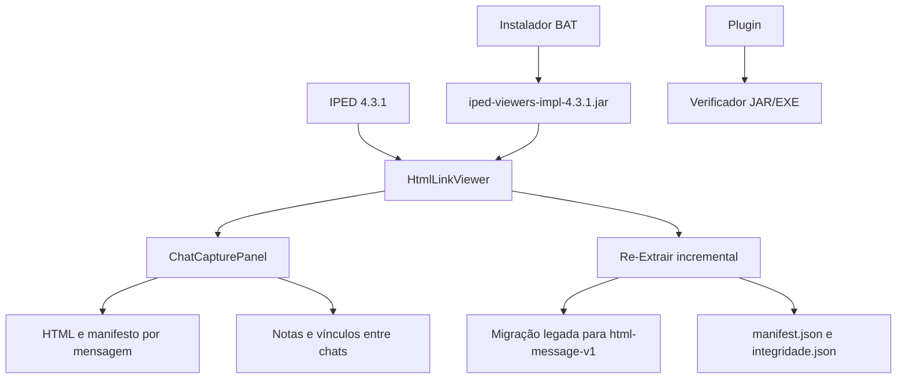

# Plugin Chat Captura IPED

**Versão:** 2.6.0-beta | Data: 12/11/2026.
**Base:** IPED 4.3.1; Java 11.

Este documento descreve o plugin Java que amplia o viewer HTML do IPED para capturar conversas WhatsApp, gerar evidências navegáveis, anotar mensagens e verificar/reextrair capturas.

Na versão 2.6.0-beta, o plugin atualiza a allowlist oficial para o **Verificador de Integridade 1.3.5**, que adiciona no resumo a opção **Copiar histórico completo público** (anonimizando nomes de pastas como `CAPTURA|*-YYYYMMDD-HHMMSS` com cálculo de SHA-256 próprio para publicação externa) e aceita de forma dual no modo **Integridade Público** tanto o formato completo original (`CAPTURA|<pasta>`) quanto o formato anonimizado (`CAPTURA|*`) e ambos os hashes SHA-256. Na versão 2.5.9-beta, a captura, o **Re-Extrair** e a migração de capturas legadas passam a aceitar qualquer ponto inicial ou final válido do WhatsApp no IPED — mensagens numéricas, registros de chamada (`_call:<hex>`), IDs removidos/carved (`-?<id>_<id>`) e timestamps internos (`iped-capture-date-...`) — normalizando `data-iped-capture-id` e `domId` entre `CaptureBoundaryResolver`, `HtmlLinkViewer` e o Verificador; além disso, o JAR do plugin torna-se um fat-JAR autocontido com classes `org/opencv/**` embutidas, busca `opencv_java4120.dll` na raiz do IPED, `plugins/` e `lib/`, e trata anexos não suportados de modo tolerante em `html-message-v1`. Na versão 2.5.8-beta, a pasta de imagens de referência (blur) funciona também em capturas `html-message-v1` (captura nova, Re-Extrair e migração de legado) via CSS puro e atributos HTML (`CaptureCensorship`), sem JavaScript adicional e mantendo compatibilidade com o Verificador, e remove `integridade/` e `integridade.html` da raiz ao re-extrair com "Limpar registros" (sem criar backups). **Aviso:** o blur CSS no `html-message-v1` é supressão visual de apresentação, não tarja irreversível; os bytes originais permanecem em `attachments/` e abrem no modal ao clicar. A versão 2.5.8-beta também deixa o índice geral sem marcar capturas `html-message-v1` como anotações legadas. Na versão 2.5.7-beta, o toggle **Limpar registros e criar como nova captura** também é habilitado para capturas já existentes em `html-message-v1`, que são recapturadas como uma nova captura, e a janela **Re-Extrair capturas** se ajusta à área útil do monitor. A versão 2.5.6-beta permite migrar capturas legadas em frames para `html-message-v1`, com validação completa da nova pasta antes da substituição e opção de preservar a cadeia de integridade ou iniciar uma nova captura. A versão 2.5.5-beta mantém a rolagem do chat ao fechar o preview de um anexo no `whatsapp.html`. A versão 2.5.4-beta normaliza o MIME de imagens embutidas no cabeçalho pela assinatura real dos bytes; assim, PNG declarado como `image/jpg` continua verificável.

## Índice

- [Arquitetura](#arquitetura)
- [Recursos](#recursos)
- [Uso no IPED](#uso-no-iped)
- [Instalação e distribuição](#instalação-e-distribuição)
- [Arquivos gerados](#arquivos-gerados)
- [Migração de capturas legadas](#migração-de-capturas-legadas)
- [Integridade e segurança](#integridade-e-segurança)
- [Desenvolvimento e validação](#desenvolvimento-e-validação)
- [Limitações conhecidas](#limitações-conhecidas)

## Arquitetura

O artefato do plugin substitui `iped-viewers-impl-4.3.1.jar` no IPED. Novas capturas são `html-message-v1` e registram HTML, mensagens, anexos e hashes por conteúdo. O modo legado baseado em imagens permanece disponível para capturas antigas, que podem ser migradas sob demanda pelo Re-Extrair. O verificador de integridade é um aplicativo independente. O instalador atualiza `org.json` para 20260719 e mantém cópias de segurança da biblioteca substituída.

O parser de SVG usado no tema aceita as opções de segurança suportadas pelo Xerces 2.12.2 do IPED 4.3.1, sem depender dos atributos JAXP `ACCESS_EXTERNAL_*` que essa implementação não reconhece. DTDs e referências externas continuam bloqueados.

## Recursos

- Novas capturas de intervalo entre marcadores inicial e final usam `html-message-v1`: HTML offline, `messages.json`, hashes por mensagem e anexos locais por SHA-256. As capturas PNG legadas continuam legíveis.
- Links de anexo do HTML do IPED que usam `app.open('sha-256:...')` são resolvidos pelo hash do item no caso. A captura inclui recursos locais dentro de limites e valida MIME/assinatura antes de gravar.
- PDF, áudio, vídeo, imagem, ZIP/OOXML, Office legado, RAR, 7z, texto/CSV e itens genéricos `.bin` são suportados pela allowlist do formato; um recurso desconhecido interrompe a captura com erro explícito.
- O `whatsapp.html` mantém o tema do IPED 4.3.1 e oferece modais locais para anexos; áudio/vídeo não iniciam automaticamente e são interrompidos ao fechar.
- Pesquisa de mensagens e navegação por coordenadas de texto e mídia.
- Marcador inicial em separador de data é resolvido para a primeira mensagem seguinte; âncoras inválidas continuam interrompendo a captura com estado explícito.
- O plugin só copia verificadores com SHA-256 permitido e valida o arquivo temporário antes de substituir uma cópia ausente ou antiga.
- Notas e vínculos entre conversas; anotações podem ser exportadas com a captura ou salvas em chats existentes.
- Censura visual de miniaturas comparadas com imagens de referência tanto no formato legado PNG (pixelização no frame) quanto em `html-message-v1` (blur CSS na miniatura + registro `censorship` em `manifest.json`; os bytes originais permanecem em `attachments/` e abrem no modal).
- Re-Extrair com comparação de inventário, reaproveitamento de conteúdo inalterado e registro de auditoria.
- Migração opt-in de capturas legadas em frames para `html-message-v1`, com marcadores persistidos, candidata temporária, validação e substituição transacional; a pasta antiga é preservada em qualquer falha anterior à promoção.
- Toggle **Limpar registros e criar como nova captura**, disponível para capturas legadas migradas e para capturas já em `html-message-v1`. Ele inicia a cadeia em `capture_created` e descarta registros, reconciliação, auditoria e anotações antigas.
- Preservação de anotações legadas em `legacy-annotations.json` quando a cadeia é mantida; elas não são vinculadas automaticamente às mensagens novas.
- Reuso de anexos legados no modo limpo somente após conferir SHA-256 e tamanho; metadados são recalculados pela fonte atual.
- Capturas `html-message-v1` sem alteração no intervalo não são substituídas; a auditoria registra `recapture_skipped_content_unchanged`.
- Registro local de integridade e integração com o verificador independente Local/Público.

## Uso no IPED

1. Abra uma conversa WhatsApp no viewer HTML.
2. Marque a mensagem inicial e final pelo menu de contexto.
3. Escolha a pasta de saída e, opcionalmente, a pasta de imagens de referência para censura visual (blur). Em `html-message-v1`, lembre-se de que o blur CSS é uma supressão visual de apresentação (não tarja definitiva: os anexos originais continuam em `attachments/`).
4. Inicie a captura. Revise os arquivos HTML e JSON produzidos.
5. Para atualizar uma captura existente, use **Re-Extrair** e confira o resumo da operação. Para converter uma captura legada, marque **Migrar capturas legadas para HTML por mensagem**; use **Limpar registros e criar como nova captura** quando quiser iniciar uma nova cadeia de integridade, inclusive em uma captura que já está em `html-message-v1`.

O modo de chat salvo permite adicionar ou editar anotações sem uma nova captura, conforme os controles disponíveis nessa tela.

## Instalação e distribuição

Feche o IPED antes de instalar. Extraia o ZIP do instalador e execute `instalar_captura_chat_zap/instalar_captura_chat_zap.bat`. O instalador valida o JAR, cria um backup, substitui o arquivo do plugin e instala os bundles de idioma. Consulte [README.md](README.md) para downloads e instruções detalhadas.

O JAR do plugin é compatível com Java 11. O verificador 1.3.4 valida a cadeia local de integridade também em capturas `html-message-v1` e confere o vínculo de `migration.json` e `legacy-annotations.json` ao inventário. Mantém a validação do script fixo de preview e o par anterior de script e CSP da versão 1.3.2, além de aceitar o MIME legado `image/jpg` quando a assinatura confirma PNG. Consulte [`verificador-integridade/README.md`](verificador-integridade/README.md). O JAR do verificador aceita Java 8 ou superior. Os hashes da build local estão em `CHECKSUMS.md`; estes artefatos ainda não foram publicados em uma release.

## Arquivos gerados

| Arquivo | Conteúdo |
|---|---|
| `screenshots/frame_*.png` | Capturas legadas: imagens em sequência |
| `whatsapp.html` | Capturas legadas: conversa navegável com links e anotações exportadas |
| `whatsapp-coordinates.json` | Capturas legadas: coordenadas e dados usados pela página |
| `manifest.json` | Metadados; `captureFormat` seleciona formato novo ou legado |
| `messages.json` | Formato novo: registros ordenados e hashes por mensagem/anexo |
| `attachments/` | Formato novo: anexos locais nomeados por SHA-256 |
| `message-reconciliation.json` | Formato novo: estados por mensagem produzidos pelo Re-Extrair |
| `migration.json` | Formato novo: proveniência de uma captura legada migrada, com hashes da origem |
| `legacy-annotations.json` | Formato novo: anotações legadas preservadas sem vínculo com as mensagens novas |
| `integridade.json` | Inventário SHA-256 e histórico de integridade da captura |
| `capturas-index.json` | Índice na raiz da saída para busca e Re-Extrair |
| `texto.txt` | Fluxo legado: texto extraído para consulta |
| `index.html`, `relatorio.htm` | Índice e relatório na raiz da saída |
| `integridade/reextracao-auditoria.jsonl` | Eventos operacionais de Re-Extrair |

No formato `html-message-v1`, `whatsapp.html` contém somente o intervalo selecionado; não executa scripts copiados do IPED nem solicita URLs externas. A única rotina ativa é o script fixo autorizado pela CSP para interromper a mídia ao fechar o modal. `messages.json` registra `domId`, contexto, chave estável, `messageHash` e anexos locais. `manifest.json` mantém âncoras, `sourceFingerprint`, `conversationKey` e `captureRootHash`. Re-Extrair exige conversa e âncoras únicas, registra mensagens inalteradas/alteradas/novas/não encontradas e só promove a saída depois de validá-la. `-Diped.chat.capture.htmlMessageV1=false` desativa temporariamente a criação de novas capturas nesse formato durante a beta; capturas HTML já existentes continuam usando a reconciliação HTML.

## Migração de capturas legadas

No diálogo **Re-Extrair capturas**, o checkbox **Migrar capturas legadas para HTML por mensagem** inicia desmarcado e se aplica somente às capturas legadas selecionadas. Capturas que já usam `html-message-v1` seguem a reconciliação normal e não são afetadas pela migração. O estado dos toggles é conservado ao navegar entre as páginas da seleção. A janela calcula o tamanho pela área útil do monitor, descontando a barra de tarefas; em 1366x768 ela fica com cerca de 879x638 px.

Quando a migração é solicitada, o plugin:

1. abre a conversa original e localiza os marcadores inicial e final persistidos;
2. gera uma candidata `html-message-v1` em pasta temporária irmã, com os mesmos limites, sanitização e hashes do fluxo normal;
3. valida `manifest.json`, `messages.json`, `whatsapp.html`, anexos locais, inventário e `conversationKey`;
4. encadeia o evento `legacy_screenshot_capture_migrated_to_html_message_v1` e grava `migration.json` quando o histórico é preservado;
5. renomeia a pasta antiga para uma pasta transacional, promove a candidata com o nome original e só então remove a pasta transacional.

Se qualquer etapa anterior à promoção falhar, somente a candidata temporária é removida; a captura legada permanece intacta. Se a promoção falhar, a pasta antiga é restaurada. A primeira migração não declara que as mensagens dos frames eram iguais às da fonte atual: ela registra que o intervalo foi localizado e reconstruído a partir da fonte atual. Depois da migração, as execuções seguintes usam os hashes por mensagem e podem ignorar intervalos sem alteração.

O toggle **Limpar registros e criar como nova captura** é habilitado com a migração marcada em uma captura legada e independentemente dela em uma captura já `html-message-v1`. Ele remove a cadeia e os registros anteriores: a pasta promovida não contém `migration.json`, `legacy-annotations.json`, `message-reconciliation.json` nem `reextracao-auditoria.jsonl`, e o novo `integridade.json` começa em `capture_created`. Em uma captura nova, o Re-Extrair ignora a comparação de conteúdo e recaptura o intervalo. Anexos legados podem ser reaproveitados somente quando SHA-256 e tamanho conferem com a origem atual; MIME, nome, tipo e caminho são recalculados. Em capturas `html-message-v1`, os anexos são extraídos novamente da fonte atual.

No modo com histórico, anotações baseadas em coordenadas são mantidas em `legacy-annotations.json`, sem vínculo automático com as novas mensagens, e o manifesto registra `migration.legacyAnnotationsPreserved`. A migração também aceita pasta de imagens de referência para censura visual (e pede confirmação caso nenhuma pasta de referência tenha sido informada).

Capturas já em `html-message-v1` não são substituídas quando `changed`, `missingInCurrentSource` e `newInInterval` são zero, salvo quando **Limpar registros e criar como nova captura** estiver marcado; nesse caso o intervalo é recapturado de fato e a candidata é promovida com uma cadeia nova. Sem o reset, a candidata é descartada, a captura atual é preservada e a auditoria recebe `recapture_skipped_content_unchanged`.

## Integridade e segurança

Hashes SHA-256 identificam o conteúdo comparado; não são assinatura digital nem provam autoria. Para comparação pública, obtenha a referência por um canal separado e confiável. O histórico encadeia eventos e mantém os hashes e inventários, mas não arquiva versões antigas dos bytes substituídos.

Em uma captura migrada com histórico, `migration.json` e `legacy-annotations.json` entram no inventário de `integridade.json`, e o manifesto referencia o hash do registro de migração. O Verificador 1.3.5 lê a cadeia local também para `html-message-v1` e acusa a divergência se o registro de migração ou as anotações preservadas forem alterados, mesmo que o manifesto seja atualizado junto. No modo **Limpar registros**, a nova captura começa em `capture_created` e não declara vínculo com a pasta legada removida.

Metadados JSON são limitados a 16 MiB, caminhos relativos a 4.096 caracteres, inventários a 25.000 arquivos e eventos cumulativos de auditoria a 16 MiB. O índice do Re-Extrair aceita até 100.000 candidatos; cada página mantém até 100 descritores e recusa metadados acima de 16 MiB. Caminhos absolutos, segmentos `.`/`..`, drives e links simbólicos são recusados ao resolver capturas. O verificador limita cada captura a 25.010 arquivos, o conjunto selecionado a 25.000 itens e 32 MiB de metadados, e os relatórios a 4 Mi caracteres estimados. Limites excedidos geram erro legível e preservam os arquivos anteriores. Escritas usam temporários exclusivos e verificação de links simbólicos nos diretórios de saída.

A descoberta de capturas do verificador e a leitura de páginas do Re-Extrair ocorrem em workers canceláveis com contador de progresso. Os metadados completos são lidos somente quando a página ou o job é processado.

O instalador cria uma cópia de segurança antes de substituir o JAR. Os hashes dos binários locais ficam em `CHECKSUMS.md`.

Limites do novo formato: 25.000 mensagens, 8 MiB por anexo, 64 MiB em anexos por captura, 1 MiB de texto extraído por mensagem e 16 MiB para o HTML fonte. A captura falha sem promover resultado quando uma referência não pode ser resolvida ou validada.

## Desenvolvimento e validação

- Fontes Java do plugin: `src/iped/viewers/`.
- Testes unitários: `tests/iped/viewers/`.
- Testes de migração legada: `teste_antes_de_aplicar/legacy_migration/`.
- Suíte completa: `teste_antes_de_aplicar/run_all_tests.ps1`, com política, fixture, transação, reconciliação, contrato de produção e integração com o verificador.
- Empacotamento do instalador: `instalar_captura_chat_zap/`.
- Artefato do plugin: `instalar_captura_chat_zap/iped-viewers-impl-4.3.1.jar`.
- O script `validate-plugin-jar.ps1` confere classes e bundles necessários.
- A suíte automatizada (`run_all_tests.ps1`, contrato de produção e `--verify-only` nas capturas de teste) passou após a compilação final de `2.6.0-beta` / Verificador `1.3.5`; a validação visual manual no WebView do IPED 4.3.1 fica a cargo do operador.
- A especificação única consolidada (incluindo itens removidos, ignorados, não aplicados e o que/como aplicar) está em [espec.md](espec.md).

## Limitações conhecidas

- O plugin requer IPED 4.3.1 e Java 11.
- A migração de capturas legadas requer que os marcadores inicial e final persistidos sejam localizados de forma única no chat atual; caso contrário, a pasta antiga é preservada e a migração daquele item falha com erro explícito.
- A captura precisa ser validada manualmente no WebView do IPED 4.3.1 com exemplos reais de cada tipo de anexo antes de distribuir a versão beta. Os testes automatizados não substituem essa verificação de integração visual.
- O hash é um mecanismo de comparação de integridade, não uma assinatura criptográfica de autoria.
- Alguns requisitos descritos em especificações antigas são parciais ou não entregues; consulte a especificação consolidada antes de presumir disponibilidade.
