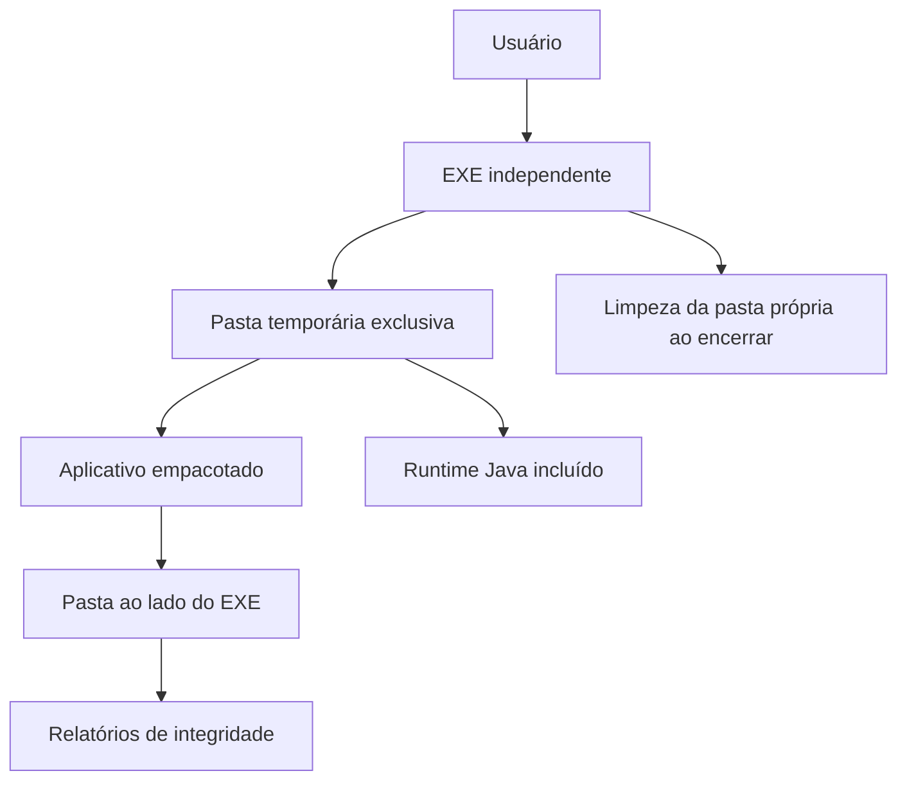

# Verificador de Integridade 1.3.4

**Versão:** 1.3.4 | Data: 08/11/2026.

## Índice

- [Visao geral](#visao-geral)
- [Arquitetura e funcionamento](#arquitetura-e-funcionamento)
- [Janelas e controles](#janelas-e-controles)
- [Execucao](#execucao)
- [Pastas temporarias](#pastas-temporarias)
- [Dependencias](#dependencias)
- [Codigos de saida e erros](#codigos-de-saida-e-erros)
- [Limitacoes e migracao](#limitacoes-e-migracao)
- [Referência pública do histórico](#referência-pública-do-histórico)

## Visao geral

Ao iniciar, o verificador oferece **Integridade Local** (compara conteúdo ao registro local) ou **Integridade Público** (compara com hash público ou histórico completo recebido externamente). A descoberta ocorre em worker cancelável e exibe a contagem atualizada sem manter a Event Dispatch Thread ocupada. Depois, lê metadados quando necessários, recalcula hashes e grava relatórios. O JAR foi compilado para Java 8 (1.8) ou superior. O EXE Windows de arquivo único contém o runtime Java 11 e .NET 10.0.14; o usuário não precisa instalar Java ou .NET.

A versão 1.3.4 valida a cadeia local de integridade também em capturas `html-message-v1`. Antes, a verificação por mensagem retornava sem ler `integridade.json`; agora a cadeia é verificada e, quando há migração, `migration.json` e `legacy-annotations.json` precisam estar vinculados ao inventário. Uma alteração no registro de migração é detectada mesmo que o manifesto seja atualizado junto. A versão mantém a validação do script fixo do `whatsapp.html` e sua CSP, que restauram a posição de rolagem ao fechar um preview; para preservar capturas existentes, também aceita o par exato de script e CSP da versão 1.3.2. A compatibilidade com `data:image/jpg` contendo assinatura PNG continua restrita a bytes cuja assinatura confirma o formato raster. O plugin 2.5.5-beta grava as capturas migradas com esse registro de proveniência.

A versão 1.3.1 reconhece `captureFormat: "html-message-v1"`. Para esse formato, valida o manifesto por mensagem, a ordem e unicidade dos IDs, `messageHash`, `captureRootHash`, caminhos confinados e os bytes SHA-256 dos anexos locais. O resultado “não encontrada na fonte atual” não atribui remoção ou autoria a ninguém.

### Capturas migradas de frames

Quando `manifest.json` contém o objeto `migration`, o verificador exige `migrationFile: "migration.json"` e o hash `migrationSha256` correspondente. O conteúdo de `migration.json` precisa ser idêntico ao objeto do manifesto, e ambos precisam declarar o mesmo estado de `legacyAnnotationsPreserved`. O inventário de `integridade.json` precisa conter `migration.json` e, quando preservado, `legacy-annotations.json` com tamanho e SHA-256 iguais. A cadeia local é a referência contra alterações posteriores; atualizar o hash no manifesto não mascara a troca do arquivo inventariado. Uma captura sem `migration` não pode conter `migration.json` nem `legacy-annotations.json`; uma captura criada com **Limpar registros** começa em `capture_created` e não carrega esses arquivos.

Na apresentação HTML 2, o verificador também permite somente o tema CSS validado, CSP canônica e script fixo com hash conhecido; o PDF é exibido apenas em `iframe sandbox=""`.

As referências do `whatsapp.html` precisam corresponder exatamente aos anexos registrados. O verificador valida assinatura binária e MIME para imagem, áudio, vídeo, PDF, ZIP/OOXML, Office legado, RAR, 7z e texto/CSV; conteúdo desconhecido só é permitido como `application/octet-stream` com extensão `.bin`. O conjunto de anexos da captura tem orçamento agregado e falha com mensagem controlada quando é excedido.

## Arquitetura e funcionamento



Cada execução cria uma pasta `instance-<pid>-<id>` dentro de `%TEMP%\Avilla\IntegridadeVerifier`. Dentro dela ficam `app`, `runtime` e um bloqueio de uso exclusivo. Execuções simultâneas usam pastas diferentes. O EXE valida os SHA-256 do pacote depois de extraí-lo.

## Janelas e controles

As telas de seleção de modo, seleção de capturas, resultado e comparação pública são `JFrame` nativos. Por isso, aparecem na barra de tarefas, podem ser minimizadas pelo botão nativo da barra de título e restauradas pelo clique na barra de tarefas. Todas permanecem fixas sobre as demais janelas (`always-on-top`), sem botão para alternar esse comportamento.

O ícone do verificador é embutido no JAR e aplicado a todas as janelas, inclusive quando o EXE extrai o aplicativo para uma pasta temporária. Fechar pelo **X** ou por **Cancelar** encerra o processo Java de forma controlada, permitindo que o lançador aguarde o término e remova a pasta temporária. Na tela de resultado, **Fechar** libera o fluxo e o processo termina normalmente; o aviso de "Nenhuma captura" também encerra o processo ao ser fechado.

As ações de copiar hashes e histórico enviam o conteúdo à área de transferência em uma thread de trabalho separada, para que uma demora do Windows não congele os controles da janela. A confirmação é exibida como diálogo associado à janela que iniciou a cópia.

## Execucao

Para abrir a interface, execute `integridade-verifier.exe` ao lado de `index.html`. O verificador usa essa pasta para localizar as capturas.

O JAR pode ser executado com Java 8 (1.8) ou superior. JSON acima de 16 MiB, profundidade acima de 64, caminhos acima de 4.096 caracteres e capturas acima de 25.010 arquivos são rejeitados com erro controlado. Uma seleção total é limitada a 10.000 capturas, 25.000 itens e 32 MiB de metadados. Relatórios acima do orçamento de 4 Mi caracteres estimados são recusados antes de montar as strings. Os hashes canônicos são atualizados em fluxo, sem montar toda a sequência na memória:

```powershell
java -jar .\integridade-verifier.jar
```

A opção interna de compilação `--self-test` extrai e valida o pacote, sem abrir a interface. A opção de teste `--self-test-hold-ms=<milissegundos>` mantém o processo aberto por até 60 segundos para conferir instâncias simultâneas.

## Pastas temporarias

Na inicialização, o EXE verifica se há outro processo do verificador em execução. Se não houver, remove os diretórios reconhecidos como resíduos antigos: `execucao-atual`, `app`, `runtime`, `app_*`, `runtime_*`, `instance-*` e `instancia-*`. Se outra instância estiver aberta, ela mantém seus arquivos temporários; a nova execução ainda inicia em sua própria pasta. Ao terminar, cada processo tenta remover somente a pasta que criou. Resíduos bloqueados ou inacessíveis são preservados para uma tentativa posterior.

## Dependencias

- Uso do JAR: Java 8 (1.8) ou superior.
- Uso do EXE: Windows x64; não requer Java nem .NET instalados.
- Build do JAR: JDK 8. Build do EXE: JDK 11 para o runtime, JDK com `jpackage`, .NET SDK 10 e PowerShell.
- O aplicativo Java usa `java.base`, `java.desktop` e a biblioteca JSON embutida no JAR standalone.
- A biblioteca embutida é `org.json` 20260719, incluindo a correção de consumo de CPU por números JSON longos (CVE-2026-59171; CWE-400/CWE-770).

## Codigos de saida e erros

| Código | Significado |
| --- | --- |
| `0` | Interface encerrada por **Fechar**, **X** ou **Cancelar**, ou teste interno de extração concluído. |
| `1` | Falha ao preparar, extrair ou validar o pacote do EXE. |

Em falhas do lançador, uma janela informa o erro. O processo Java pode apresentar mensagens próprias da interface.

## Limitacoes e migracao

A limpeza atua somente em diretórios reconhecidos dentro de `%TEMP%\Avilla\IntegridadeVerifier`; não percorre outras pastas do Windows. Se uma instância ainda estiver aberta, a limpeza geral é adiada para evitar apagar arquivos em uso. As versões 1.2.x acrescentam os modos local/público e um registro público determinístico. A versão 1.3.4 lê a cadeia local também para capturas HTML e valida a proveniência de migrações legadas. A comparação pública depende de uma referência obtida fora da pasta verificada. A gravação de relatórios cria temporários exclusivos e rejeita diretórios de saída com links simbólicos.


## Referência pública do histórico

O arquivo integridade/historico-capturas.txt usa o formato HISTORICO_PUBLICO_V1, ordena capturas por nome e não inclui o horário da execução. Assim, o hash SHA-256 permanece estável para o mesmo estado. Cada captura inclui o SHA-256 do integridade.json, que vincula o inventário e a cadeia de eventos completos, além das linhas de inventário com caminho, tamanho e hashes esperado/encontrado de cada arquivo. No modo **Integridade Público**, cole esse hash ou o conteúdo integral do arquivo recebido por canal confiável. A comparação informa igualdade com aquela referência; a checagem dos arquivos contra o inventário ainda aparece separadamente como estado local.
