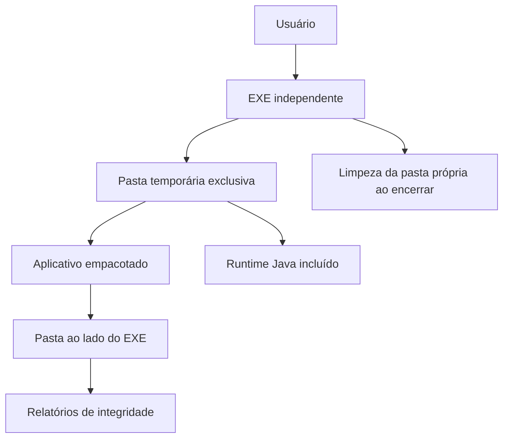

# Verificador de Integridade 1.2.4

**Versão:** 1.2.4 | Data: 06/11/2026.

## Índice

- [Visao geral](#visao-geral)
- [Arquitetura e funcionamento](#arquitetura-e-funcionamento)
- [Janelas e controles](#janelas-e-controles)
- [Execucao](#execucao)
- [Pastas temporarias](#pastas-temporarias)
- [Dependencias](#dependencias)
- [Codigos de saida e erros](#codigos-de-saida-e-erros)
- [Limitacoes e migracao](#limitacoes-e-migracao)
- [Referência pública do histórico](#referência-pública-do-histórico)

## Visao geral

Ao iniciar, o verificador oferece **Integridade Local** (compara conteúdo ao registro local) ou **Integridade Público** (compara com hash público ou histórico completo recebido externamente). Depois, lê capturas existentes, recalcula hashes e grava relatórios. O pacote oferece um JAR Java 11 e um EXE Windows de arquivo único. O EXE contém o runtime Java e o runtime .NET necessários; o usuário não precisa instalar Java ou .NET. As telas principais são janelas nativas com ícone próprio, permanecem sempre no topo e têm entrada na barra de tarefas do Windows.

## Arquitetura e funcionamento



Cada execução cria uma pasta `instance-<pid>-<id>` dentro de `%TEMP%\Avilla\IntegridadeVerifier`. Dentro dela ficam `app`, `runtime` e um bloqueio de uso exclusivo. Execuções simultâneas usam pastas diferentes. O EXE valida os SHA-256 do pacote depois de extraí-lo.

## Janelas e controles

As telas de seleção de modo, seleção de capturas, resultado e comparação pública são `JFrame` nativos. Por isso, aparecem na barra de tarefas, podem ser minimizadas pelo botão nativo da barra de título e restauradas pelo clique na barra de tarefas. Todas permanecem fixas sobre as demais janelas (`always-on-top`), sem botão para alternar esse comportamento.

O ícone do verificador é embutido no JAR e aplicado a todas as janelas, inclusive quando o EXE extrai o aplicativo para uma pasta temporária. Fechar pelo **X** ou por **Cancelar** encerra o processo Java de forma controlada, permitindo que o lançador aguarde o término e remova a pasta temporária. Na tela de resultado, **Fechar** libera o fluxo e o processo termina normalmente; o aviso de "Nenhuma captura" também encerra o processo ao ser fechado.

As ações de copiar hashes e histórico enviam o conteúdo à área de transferência em uma thread de trabalho separada, para que uma demora do Windows não congele os controles da janela. A confirmação é exibida como diálogo associado à janela que iniciou a cópia.

## Execucao

Para abrir a interface, execute `integridade-verifier.exe` ao lado de `index.html`. O verificador usa essa pasta para localizar as capturas.

O JAR pode ser executado com Java 11 ou superior:

```powershell
java -jar .\integridade-verifier.jar
```

A opção interna de compilação `--self-test` extrai e valida o pacote, sem abrir a interface. A opção de teste `--self-test-hold-ms=<milissegundos>` mantém o processo aberto por até 60 segundos para conferir instâncias simultâneas.

## Pastas temporarias

Na inicialização, o EXE verifica se há outro processo do verificador em execução. Se não houver, remove os diretórios reconhecidos como resíduos antigos: `execucao-atual`, `app`, `runtime`, `app_*`, `runtime_*`, `instance-*` e `instancia-*`. Se outra instância estiver aberta, ela mantém seus arquivos temporários; a nova execução ainda inicia em sua própria pasta. Ao terminar, cada processo tenta remover somente a pasta que criou. Resíduos bloqueados ou inacessíveis são preservados para uma tentativa posterior.

## Dependencias

- Uso do JAR: Java 11 ou superior.
- Uso do EXE: Windows x64; não requer Java nem .NET instalados.
- Build: JDK 11, JDK com `jpackage`, .NET SDK 10 e PowerShell.
- O aplicativo Java usa `java.base`, `java.desktop` e a biblioteca JSON embutida no JAR standalone.

## Codigos de saida e erros

| Código | Significado |
| --- | --- |
| `0` | Interface encerrada por **Fechar**, **X** ou **Cancelar**, ou teste interno de extração concluído. |
| `1` | Falha ao preparar, extrair ou validar o pacote do EXE. |

Em falhas do lançador, uma janela informa o erro. O processo Java pode apresentar mensagens próprias da interface.

## Limitacoes e migracao

A limpeza atua somente em diretórios reconhecidos dentro de `%TEMP%\Avilla\IntegridadeVerifier`; não percorre outras pastas do Windows. Se uma instância ainda estiver aberta, a limpeza geral é adiada para evitar apagar arquivos em uso. As versões 1.2.x acrescentam os modos local/público e um registro público determinístico. A comparação pública depende de uma referência obtida fora da pasta verificada.


## Referência pública do histórico

O arquivo integridade/historico-capturas.txt usa o formato HISTORICO_PUBLICO_V1, ordena capturas por nome e não inclui o horário da execução. Assim, o hash SHA-256 permanece estável para o mesmo estado. Cada captura inclui o SHA-256 do integridade.json, que vincula o inventário e a cadeia de eventos completos, além das linhas de inventário com caminho, tamanho e hashes esperado/encontrado de cada arquivo. No modo **Integridade Público**, cole esse hash ou o conteúdo integral do arquivo recebido por canal confiável. A comparação informa igualdade com aquela referência; a checagem dos arquivos contra o inventário ainda aparece separadamente como estado local.
