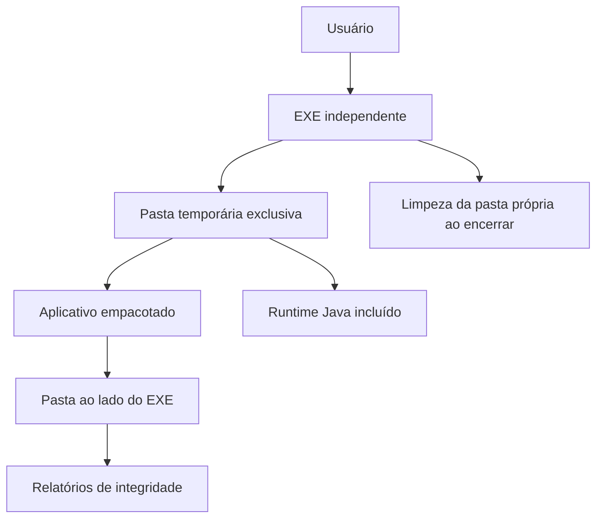

# Verificador de Integridade 1.5.1

**Versão:** 1.5.1 | Data: 16/11/2026.

> **Novidades da versão 1.5.1:** empacotamento e compilação determinísticos auditáveis multiplataforma ([`../build-reproducible.ps1`](../build-reproducible.ps1)) com Temurin JDK 21.0.13+9 + OpenJFX 21.0.5 + `.NET 10.0.15` (`-p:Deterministic=true`), mantendo todas as proteções da 1.4.4: scanner HTML léxico determinístico (`scanHtmlElements` / `parseHtmlTagStrict`), `LinkOption.NOFOLLOW_LINKS` e `maxBytes` em `openFile`, remoção de tetos artificiais de relatório, allowlists HTML/MIME simétricas com o plugin, `safeRegularFileSize` sem corrida de symlink e `html.disable` nos componentes Swing.

> **Novidades da versão 1.4.2 (F-01 a F-10):** carregamento exclusivo do ícone pelo classpath (`F-09`), `html.disable` em `JLabel`/`JCheckBox` (`F-04`), bloqueio de comentários/PIs/CDATA no HTML renderizado (`F-05`), validação obrigatória de `integridade.json` esquema >= 2 e inventário completo em `html-message-v1` (`F-01`, `F-08`), erro fechado para divergência de `captureRootHash` e histórico no CLI (`F-02`), normalização/rejeição de duplicatas na comparação pública por mensagem (`F-07`), consolidação consistente nos relatórios (`F-03`) e endurecimento do launcher para entradas de 0 bytes e limpeza temporária (`F-06`, `F-10`).

## Índice

- [Visao geral](#visao-geral)
- [Arquitetura e funcionamento](#arquitetura-e-funcionamento)
- [Janelas e controles](#janelas-e-controles)
- [Execucao](#execucao)
- [Pastas temporarias](#pastas-temporarias)
- [Dependencias](#dependencias)
- [Codigos de saida e erros](#codigos-de-saida-e-erros)
- [Limitacoes e migracao](#limitacoes-e-migracao)
- [Referência pública do histórico](#referência-pública-do-histórico)

## Visao geral

Ao iniciar, o verificador apresenta primeiro a escolha entre **Integridade Local** e **Integridade Público**. Em **Integridade Local**, o usuário escolhe as capturas desejadas e clica em **Confirmar**, exibindo uma janela de carregamento enquanto os hashes são recalculados e os relatórios são gerados antes do resumo final (**Resultado**). Em **Integridade Público**, a seleção manual de capturas é pulada: uma única janela de carregamento descobre e seleciona todas as capturas válidas, executa a verificação e abre diretamente a tela **Integridade Público** (aceitando SHA-256 do histórico completo, SHA-256 do histórico público anonimizado ou texto completo de `historico-capturas.txt` normal/anonimizado) antes de prosseguir para o resumo. O JAR foi compilado para Java 8 (1.8) ou superior. O EXE Windows de arquivo único contém o runtime Java 11 e .NET 10.0.15; o usuário não precisa instalar Java ou .NET.

A versão 1.3.5 acrescenta no resumo final o **SHA-256 do histórico completo público** e o botão **Copiar histórico completo público**, gerando linhas anonimizadas no formato `CAPTURA|*-YYYYMMDD-HHMMSS ...` (ou `CAPTURA|*`) para compartilhamento público sem expor nomes das pastas de conversa; no modo **Integridade Público**, aceita de forma dual tanto o formato completo original (`CAPTURA|<pasta>`) quanto o anonimizado (`CAPTURA|*`) e ambos os hashes SHA-256. Mantém toda a validação da cadeia local da 1.3.4 em capturas `html-message-v1` (incluindo vínculo de `migration.json` e `legacy-annotations.json` ao inventário), validação de IDs de chamada (`_call:<hex>`) e carved/removidos (`-?<id>_<id>`), script fixo de preview (`whatsapp.html`) e compatibilidade legada `data:image/jpg` com assinatura PNG. O plugin 2.5.5-beta e versões posteriores gravam as capturas migradas com esse registro de proveniência.

A versão 1.3.1 reconhece `captureFormat: "html-message-v1"`. Para esse formato, valida o manifesto por mensagem, a ordem e unicidade dos IDs, `messageHash`, `captureRootHash`, caminhos confinados e os bytes SHA-256 dos anexos locais. O resultado “não encontrada na fonte atual” não atribui remoção ou autoria a ninguém.

### Capturas migradas de frames

Quando `manifest.json` contém o objeto `migration`, o verificador exige `migrationFile: "migration.json"` e o hash `migrationSha256` correspondente. O conteúdo de `migration.json` precisa ser idêntico ao objeto do manifesto, e ambos precisam declarar o mesmo estado de `legacyAnnotationsPreserved`. O inventário de `integridade.json` precisa conter `migration.json` e, quando preservado, `legacy-annotations.json` com tamanho e SHA-256 iguais. A cadeia local é a referência contra alterações posteriores; atualizar o hash no manifesto não mascara a troca do arquivo inventariado. Uma captura sem `migration` não pode conter `migration.json` nem `legacy-annotations.json`; uma captura criada com **Limpar registros** começa em `capture_created` e não carrega esses arquivos.

Na apresentação HTML 2, o verificador também permite somente o tema CSS validado, CSP canônica e script fixo com hash conhecido; o PDF é exibido apenas em `iframe sandbox=""`.

As referências do `whatsapp.html` precisam corresponder exatamente aos anexos registrados. O verificador valida assinatura binária e MIME para imagem, áudio, vídeo, PDF, ZIP/OOXML, Office legado, RAR, 7z e texto/CSV; conteúdo desconhecido só é permitido como `application/octet-stream` com extensão `.bin`. O conjunto de anexos da captura tem orçamento agregado e falha com mensagem controlada quando é excedido.

## Arquitetura e funcionamento



Cada execução cria uma pasta `instance-<pid>-<id>` dentro de `%TEMP%\Avilla\IntegridadeVerifier`. Dentro dela ficam `app`, `runtime` e um bloqueio de uso exclusivo. Execuções simultâneas usam pastas diferentes. O EXE valida os SHA-256 do pacote depois de extraí-lo.

## Janelas e controles

As telas de seleção de modo, resultado e comparação pública são `JFrame` nativos (e a janela **Selecione as capturas**, no modo Local, utiliza `JDialog` modal com `alwaysOnTop`), assim como as janelas modais de carregamento (`SwingWorker` + `JProgressBar`) e todos os diálogos de erro/aviso (`showTopMessage`), que executam na Event Dispatch Thread com `alwaysOnTop = true`, ícone do verificador e `toFront()`. As telas principais aparecem na barra de tarefas, podem ser minimizadas pelo botão nativo da barra de título e restauradas pelo clique na barra de tarefas, permanecendo fixas sobre as demais janelas sem botão para alternar esse comportamento.

No resumo final (**Resultado**), permanecem **SHA-256 do histórico completo público**, **Copiar histórico completo**, **Copiar histórico completo público**, **Abrir histórico**, **Abrir relatório HTML** e **Fechar**. No relatório `integridade.html`, o cabeçalho exibe **Hash geral Público** (campo superior aceitando ambos os hashes SHA-256) e a validação por captura é feita em JS puro offline (sem `crypto.subtle`) contra `historico-capturas.txt` colado (normal ou anonimizado), exibindo **OK** (verde) ou **FALHA** (vermelho). Os arquivos auxiliares em `integridade/` e as saídas CLI (`--export-history`) permanecem inalterados para compatibilidade.

O ícone do verificador é embutido no JAR e aplicado a todas as janelas, inclusive quando o EXE extrai o aplicativo para uma pasta temporária. Fechar pelo **X** ou por **Cancelar** encerra o processo Java de forma controlada, permitindo que o lançador aguarde o término e remova a pasta temporária. Na tela de resultado, **Fechar** libera o fluxo e o processo termina normalmente; o aviso de "Nenhuma captura" também encerra o processo ao ser fechado.

As ações de copiar hashes e histórico enviam o conteúdo à área de transferência em uma thread de trabalho separada, para que uma demora do Windows não congele os controles da janela. A confirmação é exibida como diálogo associado à janela que iniciou a cópia.

## Execucao

Para abrir a interface, execute `integridade-verifier.exe` ao lado de `index.html`. O verificador usa essa pasta para localizar as capturas.

O JAR pode ser executado com Java 8 (1.8) ou superior. JSON acima de 16 MiB, profundidade acima de 64, caminhos acima de 4.096 caracteres e capturas acima de 25.010 arquivos são rejeitados com erro controlado. Uma seleção total é limitada a 10.000 capturas, 25.000 itens e 32 MiB de metadados. Relatórios acima do orçamento de 4 Mi caracteres estimados são recusados antes de montar as strings. Os hashes canônicos são atualizados em fluxo, sem montar toda a sequência na memória:

```powershell
java -jar .\integridade-verifier.jar
java -jar .\integridade-verifier.jar --version
java -jar .\integridade-verifier.jar --verify-only C:\caminho\capturas
.\integridade-verifier.exe --verify-only C:\caminho\capturas | Out-Host
.\integridade-verifier.exe --export-history C:\caminho\capturas | Out-Host
```

As opções CLI disponíveis tanto no JAR quanto no EXE são:

- `--verify-only [pasta]`: executa a verificação local em modo não interativo e imprime `content=`/`history=` na saída padrão (se `[pasta]` for omitida, usa a pasta do aplicativo).
- `--export-history [pasta]`: gera `integridade/historico-capturas.txt` e imprime os hashes públicos em modo não interativo.
- `--version` (`-v`): imprime a versão do verificador e sai com código `0`.
- `--self-test`: valida integridade do pacote extraído (no EXE) e autodiagnóstico de runtime/limites JSON (no JAR e no EXE), sem abrir a interface. `--self-test-hold-ms=<milissegundos>` mantém o processo aberto por até 60 segundos para testes de concorrência.
- `--help` (`-h`): exibe a sintaxe e as opções de linha de comando.

> Observação no PowerShell interativo: como `integridade-verifier.exe` é empacotado sem janela de console dedicada (`WinExe`) para evitar janelas pretas no duplo clique, encadeie `| Out-Host` ou use `Start-Process -Wait` quando desejar aguardar a conclusão e capturar a saída diretamente no terminal interativo.

## Pastas temporarias

Na inicialização, o EXE verifica se há outro processo do verificador em execução. Se não houver, remove os diretórios reconhecidos como resíduos antigos: `execucao-atual`, `app`, `runtime`, `app_*`, `runtime_*`, `instance-*` e `instancia-*`. Se outra instância estiver aberta, ela mantém seus arquivos temporários; a nova execução ainda inicia em sua própria pasta. Ao terminar, cada processo tenta remover somente a pasta que criou. Resíduos bloqueados ou inacessíveis são preservados para uma tentativa posterior.

## Dependencias

- Uso do JAR: Java 8 (1.8) ou superior.
- Uso do EXE: Windows x64; não requer Java nem .NET instalados.
- Build do JAR: JDK 8. Build do EXE: JDK 11 para o runtime, JDK com `jpackage`, .NET SDK 10 e PowerShell.
- O aplicativo Java usa `java.base`, `java.datatransfer`, `java.desktop`, `java.xml` e a biblioteca JSON embutida no JAR standalone.
- A biblioteca embutida é `org.json` 20260719, incluindo a correção de consumo de CPU por números JSON longos (CVE-2026-59171; CWE-400/CWE-770).

## Codigos de saida e erros

| Código | Significado |
| --- | --- |
| `0` | Interface encerrada por **Fechar**, **X** ou **Cancelar**, ou teste interno de extração concluído. |
| `1` | Falha ao preparar, extrair ou validar o pacote do EXE. |

Em falhas do lançador, uma janela informa o erro. O processo Java pode apresentar mensagens próprias da interface.

## Limitacoes e migracao

A limpeza atua somente em diretórios reconhecidos dentro de `%TEMP%\Avilla\IntegridadeVerifier`; não percorre outras pastas do Windows. Se uma instância ainda estiver aberta, a limpeza geral é adiada para evitar apagar arquivos em uso. As versões 1.2.x acrescentam os modos local/público e um registro público determinístico. A versão 1.3.4 lê a cadeia local também para capturas HTML e valida a proveniência de migrações legadas. A comparação pública depende de uma referência obtida fora da pasta verificada. A gravação de relatórios cria temporários exclusivos e rejeita diretórios de saída com links simbólicos.


## Referência pública do histórico

O arquivo `integridade/historico-capturas.txt` usa o formato `HISTORICO_PUBLICO_V1`, ordena capturas por nome e não inclui o horário da execução. Assim, o hash SHA-256 permanece estável para o mesmo estado. A opção **Copiar histórico completo público** produz uma variante determinística em que o nome da pasta com sufixo de timestamp é anonimizado para `*-YYYYMMDD-HHMMSS` (ou `*`), com **SHA-256 do histórico completo público** calculado separadamente. Cada captura inclui o SHA-256 do `integridade.json`, que vincula o inventário e a cadeia de eventos completos, além das linhas de inventário com caminho, tamanho e hashes esperado/encontrado de cada arquivo. No modo **Integridade Público**, cole qualquer um dos dois hashes ou o conteúdo integral do arquivo recebido por canal confiável (completo ou anonimizado). A comparação informa igualdade com aquela referência; a checagem dos arquivos contra o inventário ainda aparece separadamente como estado local.
